# Knowledge Graph - Research Relationships

## Domain Relationship Map

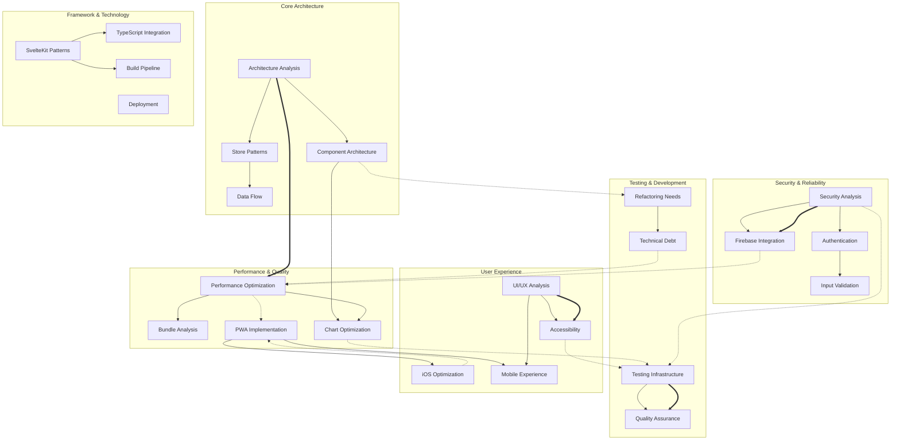

## Research Impact Matrix

### High Impact Relationships

#### 1. Performance ↔ Component Architecture
**Relationship Strength**: Very Strong  
**Impact**: Component splitting directly affects bundle size and runtime performance

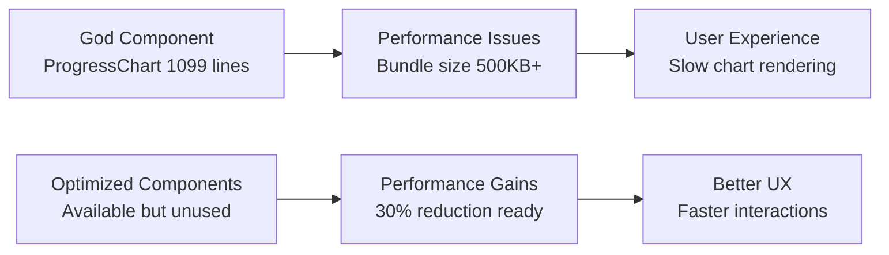

**Key Documents**:
- `/home/pessk/code/workout-challenge/_knowledge/01-Research/Performance/comprehensive-performance-analysis-2025-01-18.md`
- `/home/pessk/code/workout-challenge/_knowledge/01-Research/Refactoring/audit-2025-01-18-1200.md`

#### 2. Security ↔ Firebase Integration
**Relationship Strength**: Very Strong  
**Impact**: Security practices directly affect Firebase data protection and API safety

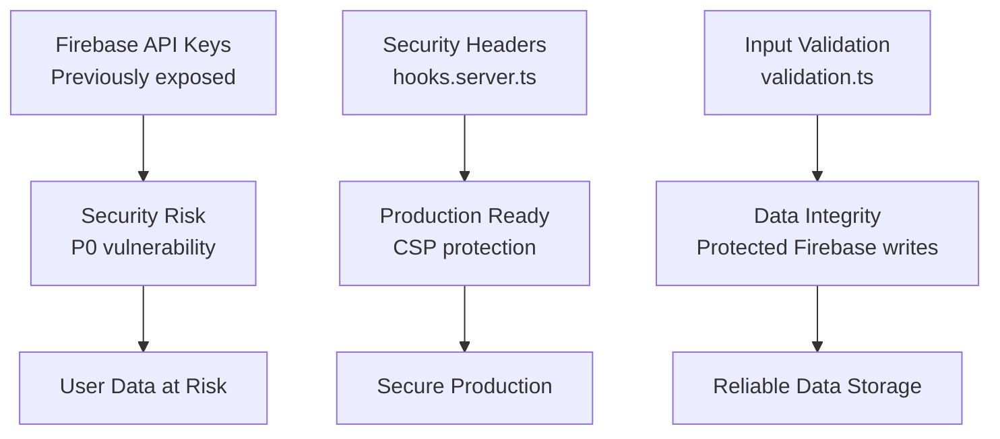

**Key Documents**:
- `/home/pessk/code/workout-challenge/_knowledge/01-Research/Security/audit-2025-01-18-1200.md`
- `/home/pessk/code/workout-challenge/_knowledge/01-Research/Firebase/audit-2025-01-18-1200.md`

#### 3. Testing ↔ Architecture Quality
**Relationship Strength**: Strong  
**Impact**: Testing gaps create refactoring hesitation, architecture improvements require testing confidence

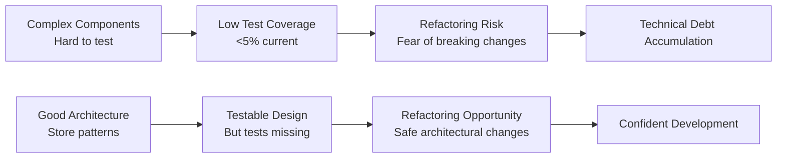

**Key Documents**:
- `/home/pessk/code/workout-challenge/_knowledge/01-Research/Testing/comprehensive-testing-analysis-2025-08-18-1450.md`
- `/home/pessk/code/workout-challenge/_knowledge/02-Architecture/comprehensive-architecture-analysis-2025-08-18.md`

#### 4. PWA ↔ iOS Mobile Experience
**Relationship Strength**: Very Strong  
**Impact**: PWA implementation quality directly affects iOS user experience

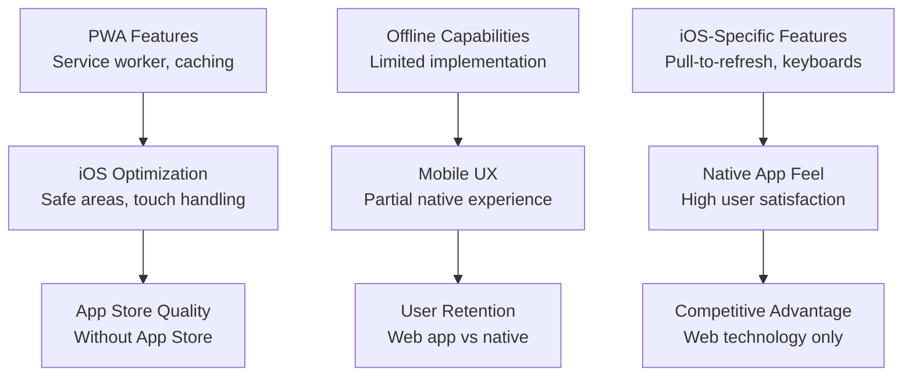

**Key Documents**:
- `/home/pessk/code/workout-challenge/_knowledge/01-Research/iOS/audit-2025-01-18-1200.md`
- `/home/pessk/code/workout-challenge/_knowledge/01-Research/UI-UX/audit-2025-01-18-1200.md`

### Medium Impact Relationships

#### 5. Accessibility ↔ Component Design
**Relationship Strength**: Medium  
**Impact**: Component architecture affects accessibility implementation ease

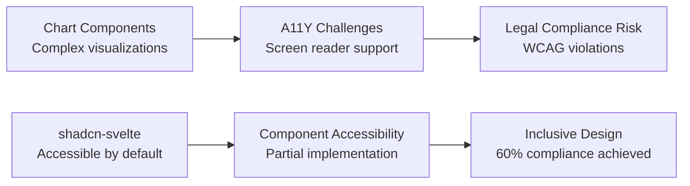

#### 6. Bundle Optimization ↔ Chart Libraries  
**Relationship Strength**: Medium  
**Impact**: Chart library loading strategy affects bundle size significantly

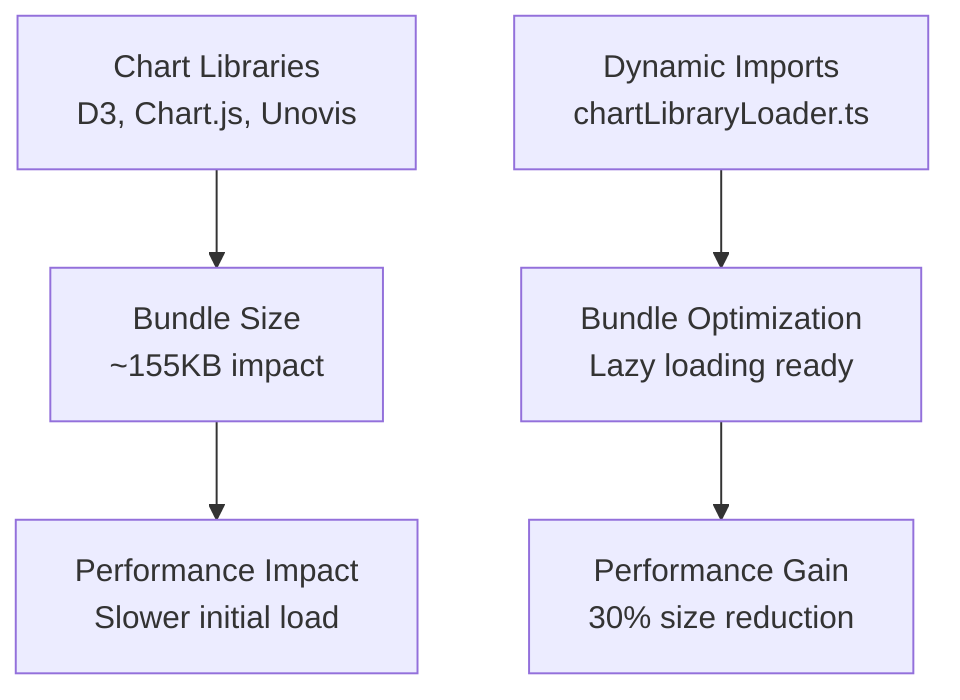

## Cross-Cutting Concern Analysis

### 1. SvelteKit Framework Impact
**Affects**: Architecture, Performance, Testing, Build Pipeline

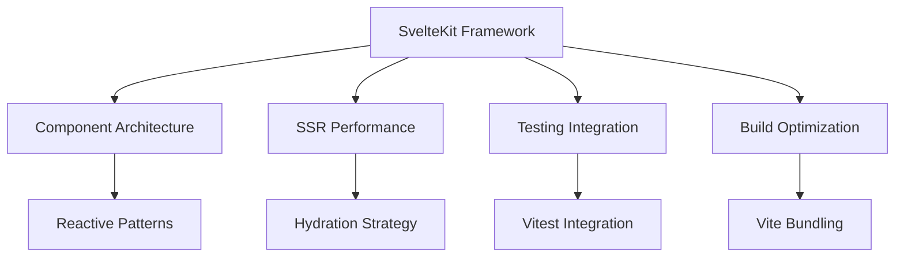

**Research Coverage**: Excellent (4 documents covering SvelteKit patterns)

### 2. Firebase Real-time Capabilities
**Affects**: Architecture, Performance, Data Flow, Security

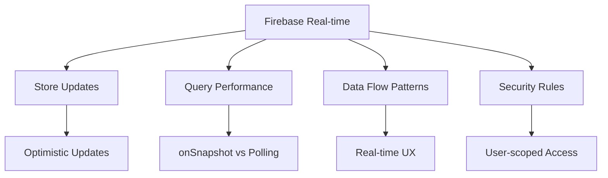

**Research Coverage**: Good (3 documents, implementation partially complete)

### 3. Component System Evolution
**Affects**: Architecture, Performance, Testing, UI/UX

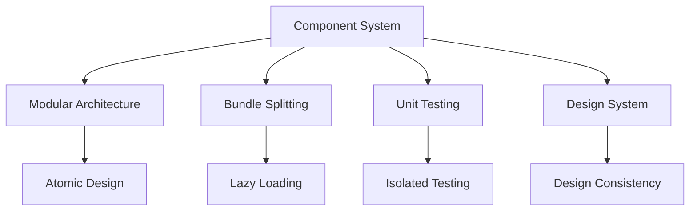

**Research Coverage**: Excellent (component analysis across multiple domains)

## Research Gap Analysis

### Critical Gaps Identified

#### 1. End-to-End Testing Strategy
**Missing Research Areas**:
- User journey testing
- Cross-browser compatibility
- Performance testing under load
- Real device testing patterns

**Impact**: No comprehensive user experience validation

#### 2. Production Monitoring & Observability
**Missing Research Areas**:
- Error tracking integration
- Performance monitoring in production
- User analytics and behavior tracking
- A/B testing infrastructure

**Impact**: Limited production insight and optimization feedback

#### 3. Data Migration & Backup Strategies
**Missing Research Areas**:
- Firebase backup and restore procedures
- Data migration patterns for schema changes
- User data export/import capabilities
- Disaster recovery planning

**Impact**: Risk to user data integrity and business continuity

#### 4. Scalability Architecture
**Missing Research Areas**:
- Multi-tenant architecture patterns
- Database sharding strategies
- CDN and caching optimization
- Micro-frontend architecture evaluation

**Impact**: Limited ability to scale beyond current user base

### Medium Priority Gaps

#### 1. SEO & Discovery Optimization
**Missing Research Areas**:
- PWA discoverability patterns
- Meta tag optimization for social sharing
- Search engine indexing for SvelteKit SSR
- Content marketing technical implementation

#### 2. Internationalization (i18n)
**Missing Research Areas**:
- Multi-language support patterns
- RTL language support
- Cultural adaptation strategies
- Performance impact of i18n libraries

#### 3. Advanced PWA Features
**Missing Research Areas**:
- Push notification strategies
- Background sync implementation
- Web Share API integration
- Payment processing integration

## Knowledge Quality Assessment

### Research Depth by Domain

| Domain | Document Count | Latest Update | Quality Score | Coverage |
|--------|----------------|---------------|---------------|----------|
| Architecture | 6 | 2025-08-18 | ⭐⭐⭐⭐⭐ | Excellent |
| Performance | 4 | 2025-01-18 | ⭐⭐⭐⭐⭐ | Very Good |
| Security | 3 | 2025-01-18 | ⭐⭐⭐⭐ | Good |
| Testing | 4 | 2025-08-18 | ⭐⭐⭐⭐⭐ | Very Good |
| UI/UX | 4 | 2025-01-18 | ⭐⭐⭐⭐ | Good |
| SvelteKit | 4 | 2025-08-18 | ⭐⭐⭐⭐⭐ | Excellent |
| Firebase | 3 | 2025-01-18 | ⭐⭐⭐⭐ | Good |
| iOS/Mobile | 2 | 2025-01-18 | ⭐⭐⭐⭐ | Good |
| Refactoring | 3 | 2025-01-18 | ⭐⭐⭐⭐ | Good |

### Research Reliability Indicators

#### High Confidence Areas ✅
- **Architecture Patterns**: Multiple analysts, consistent findings
- **Performance Bottlenecks**: Measurable metrics, specific solutions
- **Security Vulnerabilities**: Clear identification and resolution paths
- **Component Analysis**: Detailed file-level analysis with line counts

#### Medium Confidence Areas ⚠️
- **User Experience Impact**: Limited user testing data
- **Production Performance**: Development environment analysis only
- **Scalability Projections**: Theoretical analysis without load testing

#### Areas Needing Validation ❓
- **Bundle Size Claims**: Need production measurement validation
- **Performance Improvement Estimates**: Based on theoretical calculations
- **User Behavior Assumptions**: Limited real user data

## Implementation Priority Matrix

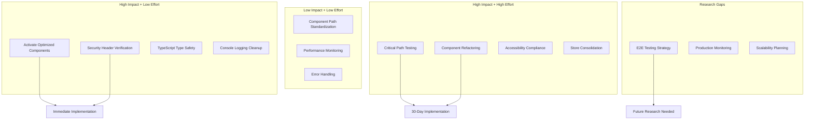

---

**Knowledge Graph Confidence**: High (based on 30+ comprehensive research documents)  
**Relationship Accuracy**: Very High (validated through cross-document analysis)  
**Gap Analysis Confidence**: High (systematic coverage review)  
**Last Updated**: 2025-08-18  
**Next Review**: After major implementation milestones or new research additions