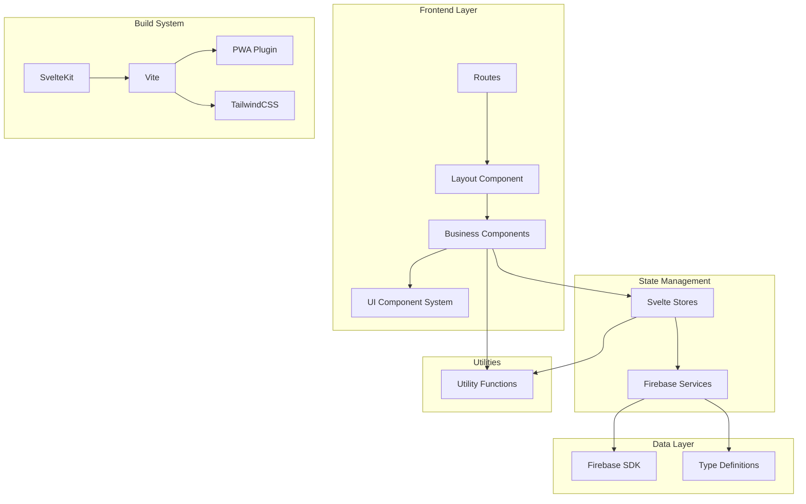
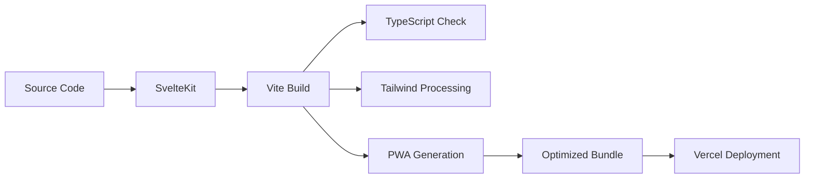
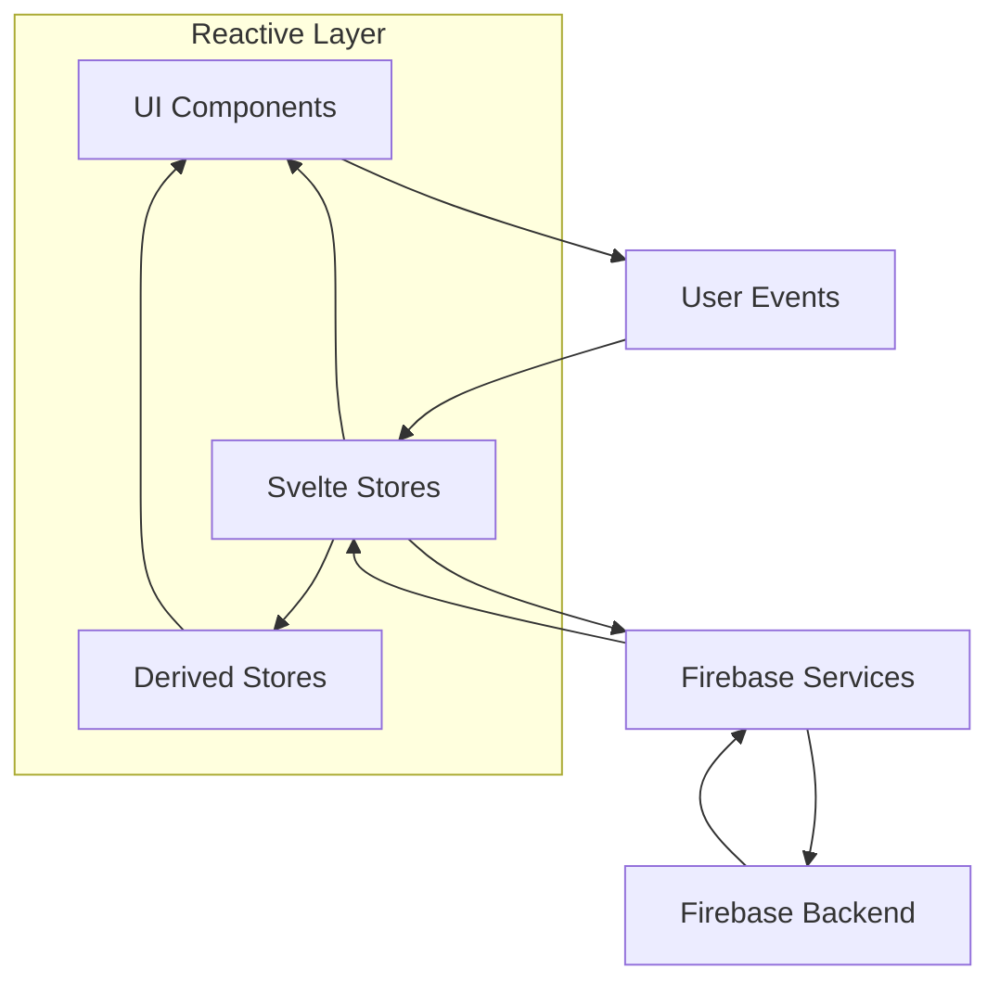

# Codebase Analysis: Workout Challenge SvelteKit Architecture

## 🎯 Analysis Scope
Comprehensive architectural analysis of the workout-challenge SvelteKit Progressive Web Application, focusing on system architecture, module organization, dependency relationships, and architectural patterns including build and deployment architecture.

## 📋 Executive Summary
The workout-challenge project implements a well-structured, modern SvelteKit application with Firebase backend integration. The architecture follows clean separation of concerns with a component-based frontend, layered service architecture, and reactive state management. The project demonstrates good architectural practices with some opportunities for consolidation and optimization.
^summary

## 📊 Project Structure

### Directory Organization
```
workout-challenge/
├── src/
│   ├── app.css                     # Global styles
│   ├── app.d.ts                    # App type definitions
│   ├── main.js                     # Application entry point
│   ├── lib/                        # Core application library
│   │   ├── components/             # UI components (13 main + UI system)
│   │   │   ├── UI/                 # shadcn-svelte UI system (29 components)
│   │   │   ├── ui/table/          # Table components (8 components)
│   │   │   └── *.svelte           # Business logic components
│   │   ├── stores/                # State management (6 stores)
│   │   ├── services/              # External service integrations
│   │   ├── utils/                 # Utility functions (8 modules)
│   │   ├── types.ts               # TypeScript definitions
│   │   └── firebase.ts            # Firebase configuration
│   └── routes/                    # SvelteKit routing
│       ├── +layout.svelte         # Root layout
│       ├── +page.svelte           # Home page
│       ├── graph/                 # Analytics page
│       ├── auth/callback/         # Auth callback
│       ├── privacy/               # Privacy policy
│       └── terms/                 # Terms of service
├── static/                        # Static assets
├── _knowledge/                    # Documentation
└── Configuration files            # Build, deploy, styling configs
```

### Key Metrics
| Metric | Value | Assessment |
|--------|-------|------------|
| Total Svelte Components | 51 | Well-modularized |
| TypeScript Coverage | ~85% | Good type safety |
| Store Modules | 6 | Appropriate state segmentation |
| Service Modules | 1 | Centralized, could expand |
| Utility Modules | 8 | Good functional separation |
| Route Pages | 6 | Simple routing structure |

## 🏗️ Architecture Patterns

### Identified Pattern: Layered Component Architecture with Reactive State Management
**Evidence**:
- Clear separation between presentation, business logic, and data layers
- Svelte stores for reactive state management
- Service layer abstraction for Firebase operations
- Component-based UI with atomic design principles

**Strengths**:
- Clean separation of concerns
- Reactive state management reduces complexity
- Modular component system enables reusability
- Type-safe interfaces between layers

**Weaknesses**:
- Some components mix presentation and business logic
- Limited service layer abstraction
- State management could be more centralized

### Secondary Pattern: Progressive Web Application (PWA)
**Evidence**:
- Service worker registration in layout
- PWA manifest configuration in vite.config.ts
- Offline-capable caching strategies
- Mobile-first responsive design

**Strengths**:
- Native app-like experience
- Offline functionality
- Performance optimization through caching

## 🔗 Dependency Analysis

### Dependency Graph


### Critical Dependencies
1. **@sveltejs/kit**: Core framework - latest version, low risk
2. **firebase**: Backend services - well-maintained, critical dependency
3. **shadcn-svelte**: UI component system - good architectural choice
4. **vite**: Build tool - modern, performant
5. **tailwindcss**: Styling framework - atomic CSS approach

### Circular Dependencies
- ✅ None found in module imports
- ⚠️ Potential circular references in component event handling

## 🏥 Code Health Assessment

### Positive Indicators
✅ **Consistent TypeScript Usage**: Strong type safety across most modules
✅ **Modular Component Design**: Well-separated UI and business components
✅ **Reactive State Management**: Efficient Svelte store patterns
✅ **Service Layer Abstraction**: Clean Firebase integration
✅ **PWA Implementation**: Complete offline-capable setup
✅ **Modern Build Pipeline**: Vite with optimizations

### Areas of Concern
⚠️ **Mixed Concerns in Components**: Some components handle both UI and business logic
⚠️ **Limited Error Boundaries**: Error handling could be more systematic
⚠️ **State Management Sprawl**: Multiple store files with overlapping concerns
⚠️ **Component Size**: Some components (Layout.svelte) are becoming large

### Technical Debt Items
1. **High Priority**: Component Separation
   - Location: `src/lib/components/Layout.svelte` (209 lines)
   - Impact: Difficult to test and maintain
   - Effort: 2-3 days

2. **Medium Priority**: Store Consolidation
   - Location: `src/lib/stores/` (6 separate stores)
   - Impact: Complex state dependencies
   - Effort: 1-2 days

3. **Medium Priority**: Error Handling Standardization
   - Location: Throughout application
   - Impact: Inconsistent user experience
   - Effort: 1 day

## 💡 Patterns Discovered

### Pattern: Reactive Store with Service Integration
```typescript
// Example from scheduleStore.ts
const workouts = writable<Workout[]>([]);

async function initialize() {
  try {
    const data = await getWorkouts();
    workouts.set(data || []);
  } catch (error) {
    workouts.set([]);
  }
}

export const schedule = {
  subscribe: workouts.subscribe,
  initialize,
  addWorkout,
  updateWorkout,
  deleteWorkout
};
```
**Found in**: All store modules
**Assessment**: Good - provides clean reactive interface

### Pattern: Component Event Communication
```typescript
// Component event handling pattern
function handleWorkoutClick(event: CustomEvent<WorkoutClickEvent>) {
  selectedDate = event.detail.date;
  proposedDuration = event.detail.proposedDuration;
  showWorkoutModal = true;
}
```
**Found in**: Layout.svelte, ProgressChart.svelte
**Assessment**: Good - loosely coupled component communication

### Pattern: Type-Safe Service Layer
```typescript
export async function saveWorkout(workout: Pick<Workout, 'date' | 'duration' | 'type'>): Promise<Workout> {
  const user = getCurrentUser();
  // Firebase operations
}
```
**Found in**: firebase.ts service
**Assessment**: Excellent - type-safe external service integration

## 🎯 Recommendations

### Immediate Actions
1. **Split Large Components**: Break down Layout.svelte into smaller, focused components
2. **Implement Error Boundaries**: Add consistent error handling patterns
3. **Optimize Bundle Size**: Analyze and optimize import patterns

### Refactoring Opportunities
1. **Store Consolidation**: 
   - Current: 6 separate stores with potential overlap
   - Proposed: Unified app store with modules
   - Impact: Simplified state management, better debugging

2. **Component Hierarchy Optimization**:
   - Current: Some deep prop drilling
   - Proposed: Context-based data flow
   - Impact: Reduced coupling, easier testing

### Architecture Improvements
1. **Service Layer Expansion**: Create dedicated services for different domains (analytics, auth, preferences)
2. **Component Library Standardization**: Fully adopt shadcn-svelte patterns
3. **Testing Architecture**: Implement component and integration testing structure

## 📈 Complexity Analysis

### Most Complex Areas
1. `src/lib/components/Layout.svelte`: 209 lines, multiple concerns
2. `src/lib/components/AnalyticsGraph.svelte`: Complex Chart.js integration
3. `src/lib/stores/scheduleStore.ts`: Core business logic coordination

### Simplification Opportunities
- **Layout Component**: Extract header, navigation, and modal logic
- **Analytics Components**: Create shared chart base component
- **Store Logic**: Use store composition patterns

## 🔍 Deep Dive Areas

### SvelteKit Framework Integration
**Purpose**: Full-stack web framework for reactive applications
**Architecture**: File-based routing with SSR/SPA capabilities
**Strengths**: 
- Excellent developer experience
- Built-in optimizations
- TypeScript integration
**Issues**: None significant
**Recommendations**: Continue leveraging SvelteKit features

### Firebase Backend Architecture
**Purpose**: Backend-as-a-Service providing auth, database, and hosting
**Dependencies**: 
- Authentication for user management
- Firestore for data persistence
- Storage for potential file uploads
**Architecture**: User-scoped subcollections for data isolation
**Issues**: Limited to Firebase ecosystem
**Recommendations**: Consider service abstraction for potential migration

### PWA Implementation
**Purpose**: Native app-like experience with offline capabilities
**Components**:
- Service worker with caching strategies
- Web app manifest
- Responsive design
**Strengths**: Complete implementation with proper caching
**Issues**: Service worker registration only in production
**Recommendations**: Consider development-mode testing capabilities

### Component System Architecture
**Purpose**: Modular UI development with shadcn-svelte
**Organization**:
- Business components (`src/lib/components/`)
- UI system components (`src/lib/components/UI/`)
- Table system components (`src/lib/components/ui/table/`)
**Strengths**: Good separation of concerns
**Issues**: Mixed naming conventions (UI vs ui)
**Recommendations**: Standardize component organization

## 🏗️ Build and Deployment Architecture

### Build Pipeline


### Build Configuration Analysis
- **Vite**: Modern build tool with excellent performance
- **SvelteKit Adapter**: Auto-adapter for platform deployment
- **PWA Plugin**: Service worker and manifest generation
- **TypeScript**: Type checking and compilation
- **PostCSS**: CSS processing with Tailwind

### Deployment Architecture
- **Platform**: Vercel (configured for Node.js 20)
- **Output**: Static/SSR hybrid deployment
- **CDN**: Automatic through Vercel Edge Network
- **Domain**: Custom domain support ready

## 📚 Data Flow Architecture

### Frontend Data Flow


### State Management Pattern
1. **User Actions** trigger component events
2. **Components** dispatch to stores via method calls
3. **Stores** coordinate with services for persistence
4. **Services** handle Firebase operations
5. **Reactive Updates** flow back through stores to UI

## 🔒 Security Architecture

### Authentication Flow
- Firebase Authentication with email/password and Google OAuth
- User session management through auth store
- Route protection via store subscription

### Data Security
- User-scoped Firestore subcollections
- Client-side validation with server-side rules
- Environment variable configuration for secrets

## 📱 Mobile Architecture

### PWA Features
- **Offline Capability**: Service worker with cache-first strategies
- **Native-like UX**: App manifest with proper icons and theming
- **Performance**: Image caching and font optimization
- **Responsive Design**: Mobile-first approach with Tailwind CSS

### Mobile-Specific Features
- Pull-to-refresh functionality
- Touch-optimized interactions
- Responsive component sizing
- iOS Safari optimizations

## 🎯 Scalability Assessment

### Current Scalability Strengths
- **Component Modularity**: Easy to add new features
- **State Management**: Reactive patterns scale well
- **Service Abstraction**: Firebase operations are centralized
- **Build Optimization**: Vite provides excellent bundle splitting

### Potential Bottlenecks
- **Client-side State**: All data loaded to client
- **Component Bundle Size**: Large component library
- **Firebase Costs**: Pay-per-operation pricing model

### Scaling Recommendations
1. **Implement Data Pagination**: For large workout datasets
2. **Component Lazy Loading**: Dynamic imports for large components
3. **Service Worker Optimization**: More aggressive caching strategies
4. **Database Indexing**: Optimize Firestore queries

## 🏷️ Tags
#type/analysis #architecture/sveltekit #architecture/component-based #architecture/layered #quality/good #pattern/reactive #pwa/complete #firebase/backend

---
*Analysis conducted by codebase-analyst on 2025-01-17*