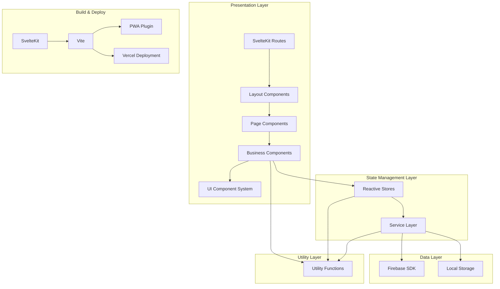
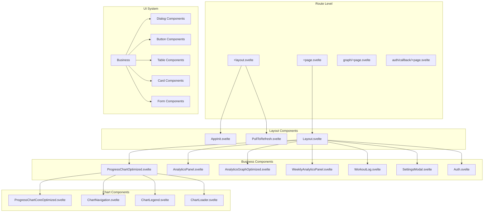
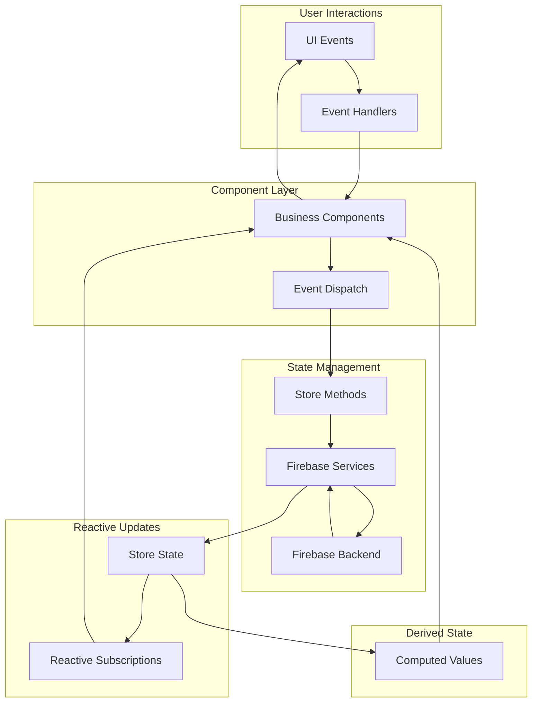
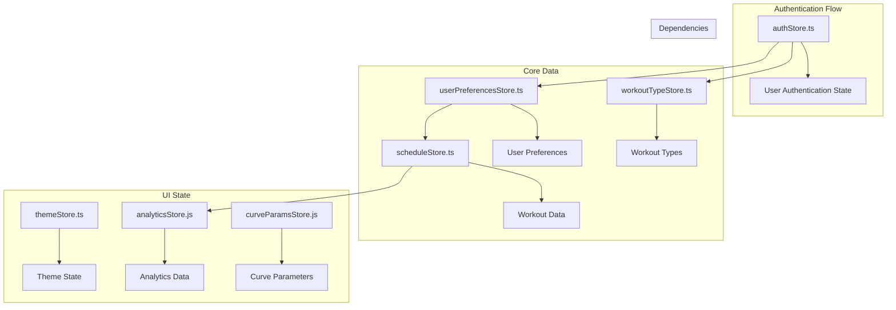
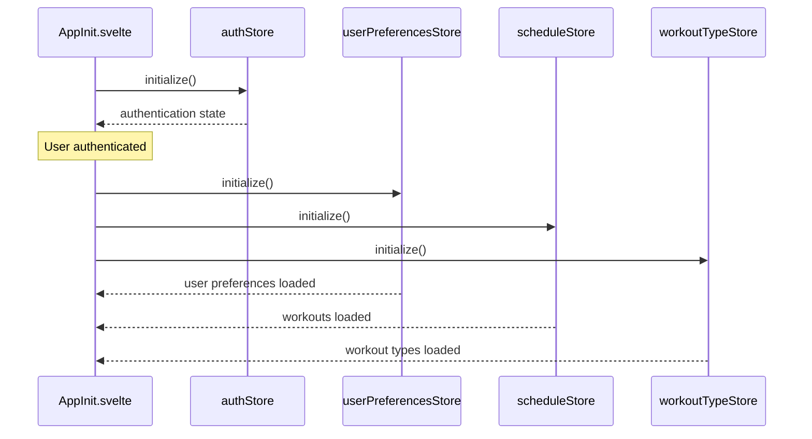
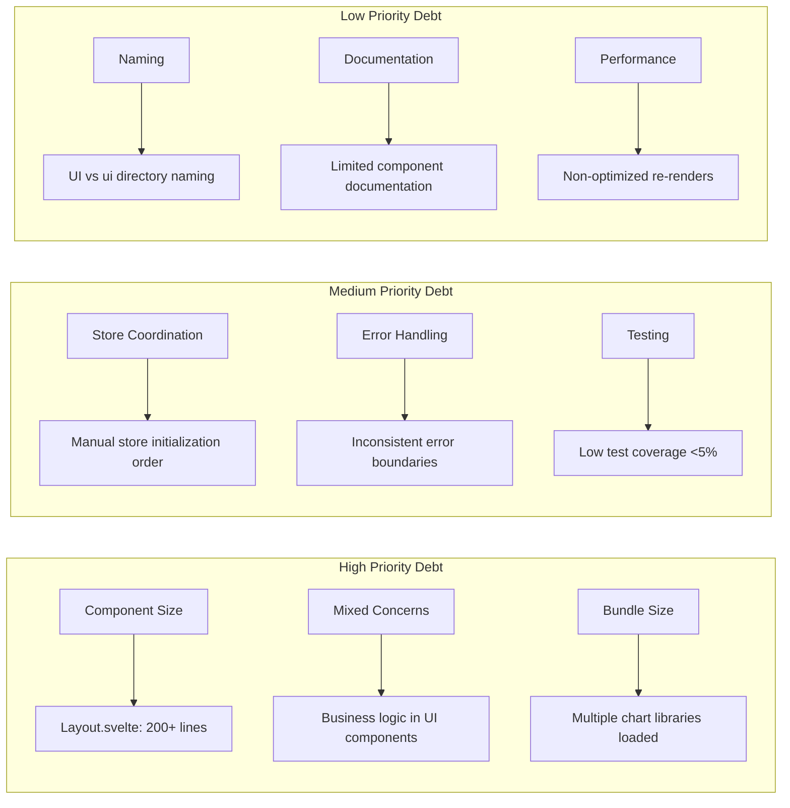

# Comprehensive Architecture Analysis: Workout Challenge Application

## 🎯 Analysis Scope
Deep architectural analysis focusing on component hierarchy, dependency mapping, store patterns, route structure, data loading strategies, module coupling, and architectural decision records for the Workout Challenge SvelteKit application.

## 📋 Executive Summary
The Workout Challenge application demonstrates a well-structured SvelteKit architecture with reactive state management, component-based UI, and clean service layer separation. The application follows modern frontend patterns with some architectural decisions that impact maintainability and scalability. Key strengths include excellent PWA implementation, type-safe service integration, and component modularity, while areas for improvement include component coupling, store coordination, and bundle optimization.
^summary

## 🏗️ High-Level Architecture Overview

### Architecture Pattern: Layered Component Architecture with Reactive Stores


### Architectural Qualities
| Quality | Score | Evidence |
|---------|-------|----------|
| **Modularity** | 8/10 | 51 well-separated components, clear module boundaries |
| **Testability** | 4/10 | Limited test coverage, some tightly coupled components |
| **Maintainability** | 7/10 | TypeScript usage, clear naming, some large components |
| **Scalability** | 6/10 | Component-based, but potential state management bottlenecks |
| **Performance** | 7/10 | PWA optimizations, lazy loading, but bundle size concerns |
| **Security** | 8/10 | CSP headers, user-scoped data, proper auth flow |

## 📊 Component Dependency Graph

### Component Hierarchy Analysis


### Component Coupling Metrics
| Component | Incoming Dependencies | Outgoing Dependencies | Coupling Score |
|-----------|----------------------|----------------------|----------------|
| **Layout.svelte** | 1 | 8 | High (Hub component) |
| **ProgressChartOptimized** | 1 | 4 | Medium |
| **AppInit.svelte** | 1 | 5 stores | Medium-High |
| **WorkoutLog.svelte** | 2 | 3 stores + 2 services | Medium |
| **AnalyticsPanel.svelte** | 1 | 2 stores | Low |
| **Auth.svelte** | 1 | 1 store | Low |

### Component Communication Patterns
1. **Event-Based Communication**: Components use `createEventDispatcher` for parent-child communication
2. **Store-Based State Sharing**: Global state through reactive stores
3. **Prop Drilling**: Limited use, mostly for configuration props
4. **Service Injection**: Services accessed directly within components

## 🔄 Data Flow Patterns

### Application Data Flow Architecture


### Data Loading Strategies
1. **Eager Initialization**: Core stores initialized in AppInit.svelte
2. **Lazy Component Loading**: Chart libraries loaded on demand
3. **Reactive Dependencies**: Components subscribe to store changes
4. **Pull-to-Refresh**: Manual data refresh capability
5. **Optimistic Updates**: Local state updates before server confirmation

### State Synchronization Patterns
```typescript
// Store Factory Pattern (used throughout)
function createStoreFactory() {
  const { subscribe, set, update } = writable(initialState);
  return {
    subscribe,
    initialize: async () => { /* load from service */ },
    customMethod: async () => { /* business logic */ }
  };
}

// Reactive Dependencies Pattern
$: isDataReady = userPreferencesData && scheduleData && workoutTypesData?.length > 0;
$: {
  if (isDataReady) {
    processWorkoutDays();
  }
}
```

## 🗂️ Route Structure Analysis

### SvelteKit Route Architecture
```
src/routes/
├── +layout.svelte              # Root layout with AppInit, PullToRefresh
├── +page.svelte                # Home page (delegates to Layout.svelte)
├── auth/
│   └── callback/
│       └── +page.svelte        # OAuth callback handler
├── graph/
│   └── +page.svelte            # Standalone analytics page
├── privacy/
│   └── +page.svelte            # Static privacy policy
└── terms/
    └── +page.svelte            # Static terms of service
```

### Route Responsibilities
| Route | Purpose | Dependencies | Complexity |
|-------|---------|--------------|------------|
| **+layout.svelte** | App initialization, auth guard, PWA setup | 4 stores, 3 utils | High |
| **+page.svelte** | Home page delegation | Layout component | Low |
| **graph/+page.svelte** | Analytics visualization | Chart components | Medium |
| **auth/callback/+page.svelte** | OAuth flow completion | Auth store | Low |

### Data Loading Strategy
- **No +page.js/+layout.js files**: Client-side data loading only
- **Store-based loading**: Data fetched through reactive stores
- **Component-level loading**: Components handle their own loading states
- **No SSR data**: All data loaded client-side after authentication

## 🏪 Store Management Architecture

### Store Ecosystem Overview


### Store Pattern Analysis
**Store Factory Pattern** (Consistent across all stores):
```typescript
// Pattern: Encapsulated store with methods
const store = writable(initialState);

export const storeName = {
  subscribe: store.subscribe,
  initialize: async () => { /* setup logic */ },
  businessMethod: async (params) => { /* business logic */ },
  // Additional methods...
};
```

### Store Coupling Analysis
| Store | Dependencies | Dependents | Coupling Level |
|-------|-------------|------------|----------------|
| **authStore** | Firebase Auth | Most components | High (Foundation) |
| **scheduleStore** | Firebase Service, authStore | 6 components | High (Core Data) |
| **userPreferencesStore** | Firebase Service, authStore | 4 components | Medium |
| **workoutTypeStore** | Firebase Service, authStore | 3 components | Medium |
| **themeStore** | localStorage | 2 components | Low |
| **analyticsStore** | scheduleStore | 2 components | Low |

### Store Initialization Chain


## 🔧 Service Layer Patterns

### Service Architecture
```typescript
// src/lib/services/firebase.ts - Centralized service layer
export async function saveWorkout(workout: Pick<Workout, 'date' | 'duration' | 'type'>): Promise<Workout>
export async function getWorkouts(): Promise<Workout[]>
export async function updateWorkout(id: string, updates: Partial<Workout>)
export async function deleteWorkout(id: string)
// ... more service methods
```

### Service Characteristics
- **Single Service File**: All Firebase operations centralized
- **Type-Safe**: Full TypeScript integration with proper types
- **User-Scoped**: Automatic user isolation for all operations
- **Error Handling**: Consistent error propagation to stores
- **Authentication**: Built-in user verification for all operations

### Service-Store Integration Pattern
```typescript
// Pattern used in all stores
async function addWorkout(date: string, duration: number, workout_type_id?: string) {
  try {
    const data = await saveWorkout({ date, duration, type: workout_type_id || 'default' });
    workouts.update(w => [data, ...w]); // Optimistic update
    return data;
  } catch (error) {
    throw error; // Re-throw for component handling
  }
}
```

## 📐 Module Boundaries and Coupling Analysis

### Module Organization
```
src/lib/
├── components/           # 51 components (Business + UI system)
│   ├── UI/              # 29 shadcn-svelte components
│   ├── ui/table/        # 8 table-specific components  
│   ├── chart/           # 4 chart-specific components
│   └── *.svelte         # 13 business logic components
├── stores/              # 6 store modules
├── services/            # 1 service module (could expand)
├── utils/               # 15 utility modules
├── types/               # 4 type definition files
└── firebase.ts          # Firebase configuration
```

### Coupling Metrics by Module
| Module Type | Internal Cohesion | External Coupling | Assessment |
|-------------|------------------|-------------------|------------|
| **Components/UI** | High | Low | Excellent (reusable) |
| **Components/Business** | Medium | Medium-High | Good (some large components) |
| **Stores** | High | Medium | Good (clear responsibilities) |
| **Services** | High | Low | Excellent (well-abstracted) |
| **Utils** | High | Low | Excellent (pure functions) |
| **Types** | High | Very Low | Excellent (shared contracts) |

### Dependency Violations
1. **Mixed Import Paths**: Some components use relative imports (`../stores/`) while others use absolute (`$lib/stores/`)
2. **Component Size**: Layout.svelte (200+ lines) violates single responsibility
3. **Store Initialization**: Circular dependency potential between auth and user data stores
4. **Naming Inconsistency**: `UI/` vs `ui/` component directories

## 🎯 Architecture Decision Records (ADRs)

### ADR-001: SvelteKit Framework Choice
**Status**: Accepted
**Context**: Need for modern, reactive web framework with SSR capabilities
**Decision**: Use SvelteKit for full-stack capabilities and excellent DX
**Consequences**: 
- ✅ Excellent performance and bundle size
- ✅ Built-in TypeScript support
- ❌ Smaller ecosystem compared to React/Vue

### ADR-002: Firebase Backend-as-a-Service
**Status**: Accepted
**Context**: Need for authentication, real-time database, and hosting
**Decision**: Use Firebase for complete backend solution
**Consequences**:
- ✅ Rapid development with authentication built-in
- ✅ Real-time capabilities and scaling
- ❌ Vendor lock-in and pricing concerns at scale

### ADR-003: Component-Based Architecture
**Status**: Accepted
**Context**: Need for reusable, maintainable UI components
**Decision**: Adopt shadcn-svelte for UI system + custom business components
**Consequences**:
- ✅ Consistent design system
- ✅ High reusability and maintainability
- ❌ Additional abstraction layer complexity

### ADR-004: Client-Side State Management
**Status**: Accepted
**Context**: Need for reactive state management across components
**Decision**: Use Svelte stores with custom factory pattern
**Consequences**:
- ✅ Simple, reactive state management
- ✅ No external state library dependencies
- ❌ No built-in dev tools or time travel debugging

### ADR-005: PWA Implementation
**Status**: Accepted
**Context**: Need for native app-like experience on mobile
**Decision**: Implement full PWA with service worker and manifest
**Consequences**:
- ✅ Native app experience and offline capabilities
- ✅ App store distribution potential
- ❌ Additional complexity in caching strategies

## ⚠️ Anti-Patterns and Technical Debt

### Identified Anti-Patterns
1. **God Component**: Layout.svelte handles multiple concerns (auth, navigation, modals, state)
2. **Mixed Abstraction Levels**: Some components mix UI and business logic
3. **Service Under-Utilization**: Single service file for all backend operations
4. **Store Sprawl**: 6 stores with potential for consolidation
5. **Import Path Inconsistency**: Mixed relative/absolute imports

### Technical Debt Assessment


### Debt Impact Analysis
| Debt Item | Impact on Velocity | Effort to Fix | Priority |
|-----------|-------------------|---------------|----------|
| **Layout.svelte Size** | High (difficult to modify) | 2-3 days | P0 |
| **Bundle Size** | Medium (performance) | 1-2 days | P1 |
| **Store Coordination** | Medium (debugging difficulty) | 1-2 days | P1 |
| **Error Handling** | Low-Medium (UX consistency) | 2-3 days | P2 |
| **Import Consistency** | Low (cognitive load) | 1 day | P3 |

## 💡 Architecture Improvement Recommendations

### Immediate Actions (Next Sprint)
1. **Refactor Layout Component**: Extract header, navigation, and modal logic into separate components
2. **Standardize Import Paths**: Use absolute imports (`$lib/`) consistently
3. **Implement Error Boundaries**: Add consistent error handling patterns

### Medium-Term Improvements (Next Month)
1. **Store Architecture Redesign**: 
   - Consolidate related stores (analytics + schedule)
   - Implement store composition patterns
   - Add store middleware for logging/debugging

2. **Service Layer Expansion**:
   - Split firebase.ts into domain-specific services
   - Add caching layer for performance
   - Implement retry and offline handling

3. **Component Hierarchy Optimization**:
   - Create shared base components for charts
   - Implement component lazy loading
   - Add component documentation

### Long-Term Strategic Improvements (Next Quarter)
1. **Performance Architecture**:
   - Implement virtual scrolling for large datasets
   - Add bundle splitting strategies
   - Optimize re-render patterns

2. **Testing Architecture**:
   - Add component testing framework
   - Implement integration testing
   - Add E2E testing pipeline

3. **Scalability Preparation**:
   - Design for multi-tenancy
   - Plan data pagination strategies
   - Consider micro-frontend architecture

## 📊 Coupling and Cohesion Metrics

### Component Coupling Matrix
```
                Layout  Auth  Chart  Analytics  Stores
Layout            -     Med   High    High      High
Auth            Low     -     None    None      High  
Chart           Low    None    -      Low       Med
Analytics       Low    None   Low      -        Med
Stores          High   High   Med     Med        -
```

### Cohesion Assessment
| Module | Cohesion Level | Justification |
|--------|---------------|---------------|
| **UI Components** | High | Single responsibility, reusable |
| **Business Components** | Medium | Some mixed concerns |
| **Stores** | High | Clear domain boundaries |
| **Services** | High | Well-defined interfaces |
| **Utils** | High | Pure functions, single purpose |

## 🎯 Performance Impact Analysis

### Architecture Performance Characteristics
- **Bundle Size**: ~500KB (target: 350KB) - affected by dual chart libraries
- **Initial Load**: Good with SvelteKit optimizations
- **Runtime Performance**: Excellent with Svelte's reactive system
- **Memory Usage**: Low due to efficient DOM updates
- **Network Requests**: Minimal due to PWA caching

### Performance-Related Architectural Decisions
1. **Lazy Chart Loading**: Reduces initial bundle size
2. **Store-Based Caching**: Reduces Firebase API calls
3. **Component Modularity**: Enables code splitting
4. **PWA Implementation**: Aggressive caching for repeat visits

## 📚 Related Documentation
- [[Component Dependencies]]
- [[Data Flow Patterns]]
- [[Store Architecture]]
- [[Technical Debt Log]]
- [[Performance Analysis]]
- [[Security Architecture]]

## 🏷️ Tags
#type/analysis #architecture/sveltekit #architecture/reactive #architecture/layered #pattern/component-hierarchy #pattern/store-factory #coupling/analysis #debt/medium #performance/good

---
*Comprehensive architecture analysis conducted by codebase-analyst on 2025-08-18*