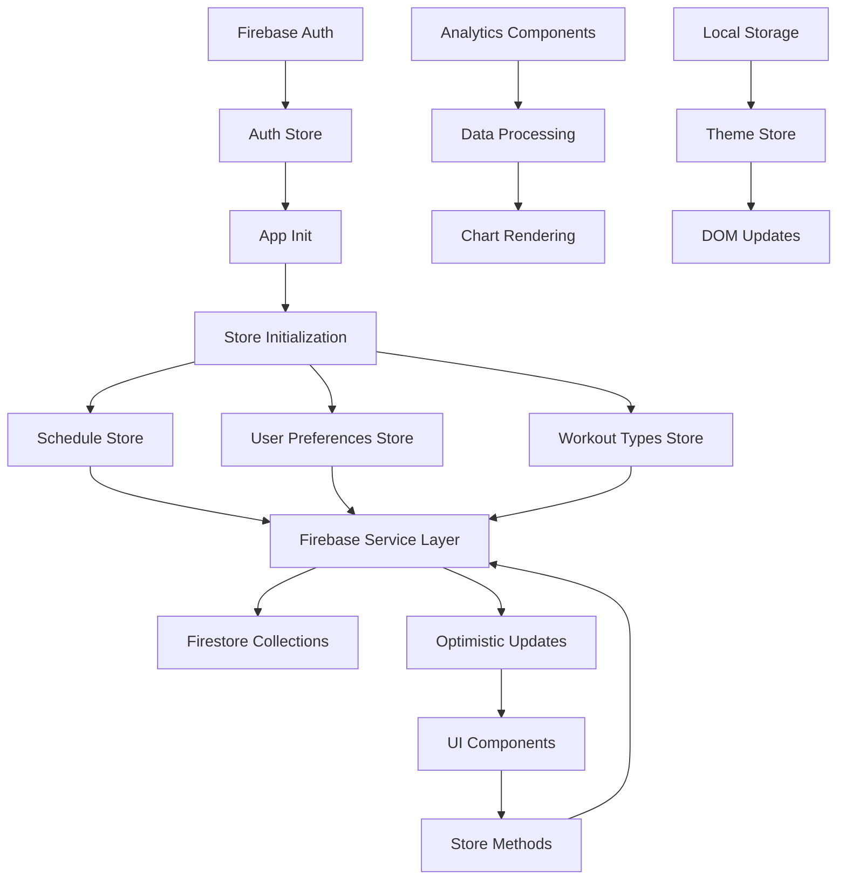
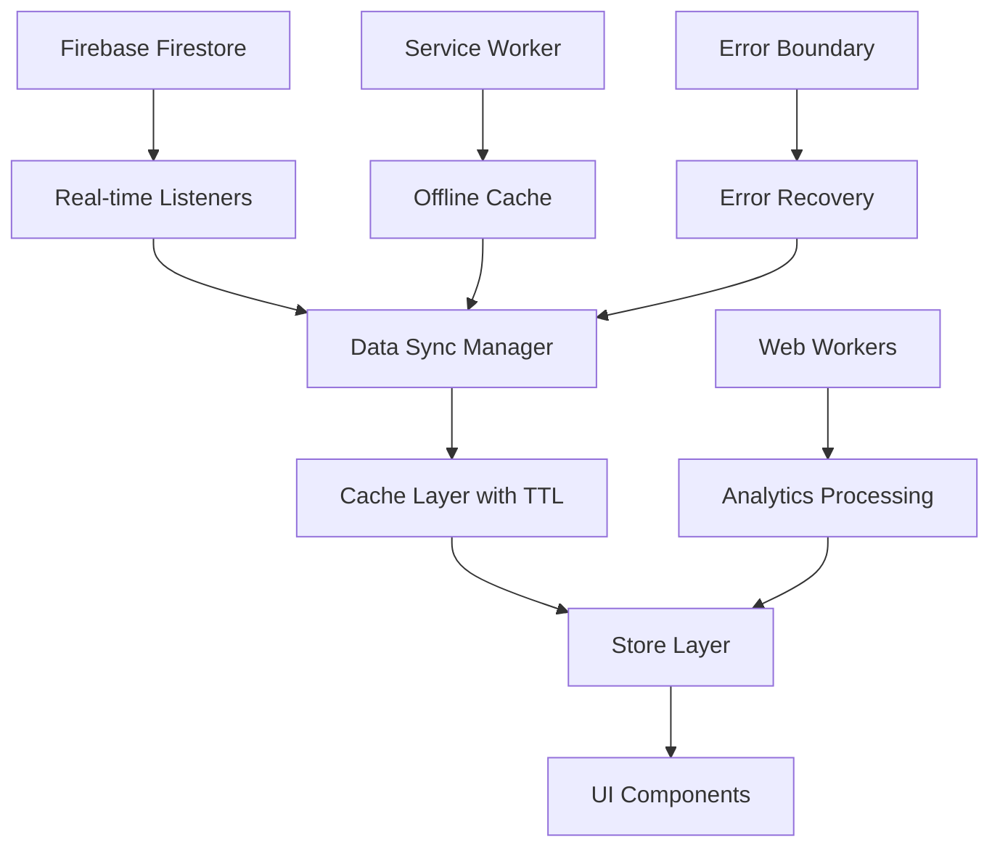

# Data Flow Research: Workout Challenge Application
Date: 2025-01-17 15:00
Agent: data-flow-researcher

## Executive Summary
The Workout Challenge application follows a unidirectional data flow pattern with Firebase as the single source of truth. However, it lacks real-time synchronization and has several performance bottlenecks in data fetching and state management patterns.

## Context
- Project: Workout Challenge - 90-Day Fitness Tracking Application
- Current architecture: SvelteKit + Firebase (Auth + Firestore) + Custom Store Layer
- Complexity level: Medium - Multiple interconnected stores with complex data transformations
- Related research: Framework audit available in CLAUDE.md

## Current Data Flow Analysis

### Data Sources
- APIs: Firebase Firestore REST API (via Firebase SDK)
- Databases: Firebase Firestore (NoSQL document database)
- Local storage: Theme preferences, chart library caching
- Third-party services: Firebase Authentication (Email/Password, Google OAuth)

### State Locations
```
Application State Map:
├── Global State (Svelte Stores)
│   ├── Auth State (authStore)
│   │   ├── User data (id, email)
│   │   └── Loading state
│   ├── Schedule Store (workouts)
│   │   ├── Workout array
│   │   └── CRUD operations
│   ├── User Preferences
│   │   ├── Sigmoid parameters
│   │   ├── Days per week
│   │   └── Start date
│   ├── Workout Types
│   │   ├── Type definitions
│   │   └── Color mappings
│   └── Theme Store
│       └── Dark/light mode
├── Component State
│   ├── Chart visualization state
│   ├── Modal open/close states
│   ├── Form input values
│   └── UI interaction state
└── Server State (Firebase)
    ├── User-scoped collections
    │   ├── /users/{userId}/workouts
    │   ├── /users/{userId}/workout_types
    │   └── /users/{userId}/user_preferences
    └── Authentication state
```

### Data Flow Paths


## Key Findings

### Finding 1: No Real-time Data Synchronization
**Current Implementation**:
```javascript
// All data fetching is request/response based
export async function getWorkouts(): Promise<Workout[]> {
  const user = getCurrentUser();
  const q = query(
    collection(db, 'users', user.uid, 'workouts'),
    orderBy('date', 'desc')
  );
  const querySnapshot = await getDocs(q);
  return querySnapshot.docs.map(doc => ({
    id: doc.id,
    ...doc.data()
  } as Workout));
}
```

**Analysis**:
- Strengths: Simple, predictable data flow
- Weaknesses: No real-time updates, stale data possible, manual refresh required
- Scalability: Poor for multi-device usage

**Recommended Approach**:
```javascript
// Real-time listeners for live updates
export function subscribeToWorkouts(callback: (workouts: Workout[]) => void) {
  const user = getCurrentUser();
  const q = query(
    collection(db, 'users', user.uid, 'workouts'),
    orderBy('date', 'desc')
  );
  
  return onSnapshot(q, (querySnapshot) => {
    const workouts = querySnapshot.docs.map(doc => ({
      id: doc.id,
      ...doc.data()
    } as Workout));
    callback(workouts);
  });
}
```

### Finding 2: Inefficient Store Initialization Pattern
**Current Implementation**:
```javascript
// Sequential initialization in multiple components
onMount(async () => {
  await Promise.all([
    workoutTypes.initialize(),
    schedule.initialize()
  ]);
});
```

**Analysis**:
- Strengths: Predictable loading order
- Weaknesses: Multiple redundant initializations, no global coordination
- Scalability: N+1 initialization calls across components

**Recommended Approach**:
```javascript
// Centralized initialization with caching
export const dataManager = {
  initialized: false,
  async initializeAll() {
    if (this.initialized) return;
    
    await Promise.all([
      authStore.initialize(),
      userPreferences.initialize(),
      workoutTypes.initialize(),
      schedule.initialize()
    ]);
    
    this.initialized = true;
  }
};
```

### Finding 3: Heavy Data Processing in UI Components
**Current Implementation**:
```javascript
// Complex calculations in AnalyticsPanel.svelte (356 lines)
function calculateDailyAverages() {
  if (!workouts || workouts.length === 0) return;
  const sortedWorkouts = [...workouts].sort((a, b) => new Date(a.date).getTime() - new Date(b.date).getTime());
  // ... 50+ lines of complex date/time calculations
}
```

**Analysis**:
- Strengths: Self-contained logic
- Weaknesses: UI blocking calculations, duplicated processing logic
- Scalability: Poor performance with large datasets

**Recommended Approach**:
```javascript
// Extract to dedicated data processing service
export class WorkoutAnalytics {
  private cache = new Map();
  
  getDailyAverages(workouts: Workout[], preferences: UserPreferences) {
    const cacheKey = this.getCacheKey(workouts, preferences);
    if (this.cache.has(cacheKey)) {
      return this.cache.get(cacheKey);
    }
    
    const result = this.calculateDailyAverages(workouts, preferences);
    this.cache.set(cacheKey, result);
    return result;
  }
}
```

## State Management Analysis

### Current Solution
- Technology: Custom Svelte store factories with embedded methods
- Complexity: Medium - 5 main stores with cross-dependencies
- Performance: Adequate for current scale but has inefficiencies

### Store Factory Pattern Analysis
```javascript
// Effective pattern but lacks standardization
function createWorkoutTypeStore() {
  const { subscribe, set, update } = writable([]);
  return {
    subscribe,
    initialize: async () => { /* Firebase call */ },
    addWorkoutType: async (name, color) => { /* CRUD operation */ },
    // ... other methods
  };
}
```

**Strengths**:
- Clean API separation
- Encapsulated business logic
- Type-safe operations

**Weaknesses**:
- No error state management
- Inconsistent error handling patterns
- No loading indicators
- No optimistic updates

### Recommendations
1. **Short-term**: Standardize error handling across all stores
2. **Medium-term**: Add loading states and optimistic updates
3. **Long-term**: Consider migrating to TanStack Query for better cache management

## API Integration Patterns

### Current Approach
```javascript
// Direct Firebase SDK usage through service layer
export async function saveWorkout(workout) {
  const user = getCurrentUser();
  const workoutData = {
    user_id: user.uid,
    date: workout.date,
    duration: workout.duration,
    type: workout.type || 'default',
    created_at: new Date().toISOString()
  };
  const docRef = await addDoc(collection(db, 'users', user.uid, 'workouts'), workoutData);
  return { id: docRef.id, ...workoutData };
}
```

### Suggested Improvements
```javascript
// Enhanced service with better error handling and caching
export class WorkoutService {
  private cache = new Map();
  
  async saveWorkout(workout: WorkoutInput): Promise<Workout> {
    try {
      const result = await this.performSave(workout);
      this.invalidateCache(['workouts', 'analytics']);
      return result;
    } catch (error) {
      throw new WorkoutError('Failed to save workout', { cause: error, data: workout });
    }
  }
  
  private invalidateCache(keys: string[]) {
    keys.forEach(key => this.cache.delete(key));
  }
}
```

## Data Validation Strategy
- Input validation: Basic validation with `validation.ts` utility
- Schema validation: No runtime schema validation
- Type safety: TypeScript interfaces without runtime checks
- Error boundaries: No error boundaries implemented

### Current Validation Gaps
```javascript
// Basic validation but no schema enforcement
export function validateWorkout(duration: number, date: string, type: string | null) {
  const errors: string[] = [];
  
  if (!duration || duration <= 0) {
    errors.push('Duration must be greater than 0');
  }
  // ... basic checks only
}
```

### Recommended Enhancement
```javascript
// Schema-based validation with Zod
const WorkoutSchema = z.object({
  date: z.string().datetime(),
  duration: z.number().min(1).max(480),
  type: z.string().min(1)
});

export function validateWorkout(data: unknown): WorkoutValidation {
  const result = WorkoutSchema.safeParse(data);
  return {
    isValid: result.success,
    data: result.success ? result.data : null,
    errors: result.success ? [] : result.error.flatten().fieldErrors
  };
}
```

## Performance Considerations
- Bundle size impact: 500KB+ (both D3.js and Chart.js loaded)
- Runtime performance: Heavy DOM manipulation in charts
- Memory usage: No cleanup of D3 event listeners
- Network efficiency: No request deduplication or caching

### Critical Performance Issues
1. **Chart Library Bloat**: Both D3.js (~150KB) and Chart.js (~100KB) loaded
2. **DOM Recreation**: Charts completely rebuild on every data change
3. **No Request Caching**: Identical API calls not deduplicated
4. **Memory Leaks**: Event listeners not properly cleaned up

### Performance Optimization Roadmap
```javascript
// Lazy loading with dynamic imports
const loadChartLibrary = async (type: 'd3' | 'chartjs') => {
  switch (type) {
    case 'd3':
      return await import('d3');
    case 'chartjs':
      return await import('chart.js');
  }
};

// Request deduplication
class RequestDeduplicator {
  private pending = new Map();
  
  async dedupe<T>(key: string, fn: () => Promise<T>): Promise<T> {
    if (this.pending.has(key)) {
      return this.pending.get(key);
    }
    
    const promise = fn();
    this.pending.set(key, promise);
    
    try {
      const result = await promise;
      this.pending.delete(key);
      return result;
    } catch (error) {
      this.pending.delete(key);
      throw error;
    }
  }
}
```

## Migration Path

### Phase 1: Immediate Improvements (1-2 weeks)
1. **Standardize Error Handling**
   - Create `AppError` base class
   - Implement consistent error propagation
   - Add error boundaries for UI components

2. **Add Loading States**
   - Extend store pattern with loading flags
   - Implement skeleton loading components
   - Add optimistic update patterns

3. **Request Deduplication**
   - Implement request cache layer
   - Add automatic cleanup for stale requests

### Phase 2: Architecture Enhancement (1 month)
1. **Real-time Data Sync**
   - Migrate from `getDocs` to `onSnapshot`
   - Implement connection state management
   - Add offline support patterns

2. **Performance Optimization**
   - Lazy load chart libraries
   - Implement virtual scrolling for large datasets
   - Add incremental chart updates

3. **Data Processing Optimization**
   - Extract analytics to web workers
   - Implement result caching
   - Add progressive data loading

### Phase 3: Advanced Features (2-3 months)
1. **Advanced Cache Management**
   - Implement TanStack Query or similar
   - Add cache invalidation strategies
   - Background data synchronization

2. **Real-time Collaboration**
   - Multi-device data synchronization
   - Conflict resolution strategies
   - Presence indicators

## Testing Strategies
- Unit testing state: No current tests for stores
- Integration testing data flows: Missing end-to-end data flow tests
- Mocking strategies: No established mocking patterns
- E2E data scenarios: No comprehensive user journey tests

### Recommended Testing Architecture
```javascript
// Store testing with mock Firebase
describe('Schedule Store', () => {
  beforeEach(() => {
    mockFirebase.reset();
    scheduleStore.reset();
  });

  it('should handle optimistic updates correctly', async () => {
    const workout = { date: '2025-01-17', duration: 30, type: 'cardio' };
    
    // Should immediately update UI
    const promise = scheduleStore.addWorkout(workout);
    expect(get(scheduleStore)).toContainEqual(expect.objectContaining(workout));
    
    // Should handle server confirmation
    await promise;
    expect(mockFirebase.collection).toHaveBeenCalledWith('workouts');
  });
});
```

## Sources
- Documentation reviewed: Firebase Firestore docs, Svelte store documentation
- Codebase files analyzed: 
  - `/src/lib/stores/*.ts` - All store implementations
  - `/src/lib/services/firebase.ts` - API integration layer
  - `/src/lib/components/*.svelte` - UI data consumption patterns
  - `/src/lib/utils/*.ts` - Data processing utilities
- Patterns researched: Svelte store patterns, Firebase real-time patterns

## Related Research
- Framework state management: See CLAUDE.md for SvelteKit patterns
- Performance research: Bundle analysis in audit report
- API/Backend research: Firebase integration patterns

## Recommendations Priority

### Critical (P0)
1. **Implement Error Boundaries**: Prevent cascading failures in data operations
2. **Add Request Deduplication**: Prevent duplicate Firebase calls
3. **Standardize Error Handling**: Consistent error propagation across stores

### Important (P1)
1. **Real-time Data Sync**: Migrate to Firebase listeners for live updates
2. **Performance Optimization**: Lazy load chart libraries, optimize rendering
3. **Loading State Management**: Add proper loading indicators throughout app

### Nice to have (P2)
1. **Advanced Caching**: Implement sophisticated cache invalidation
2. **Offline Support**: Add offline-first data patterns
3. **Data Processing Workers**: Move heavy calculations to web workers

## Open Questions
1. **Real-time Requirements**: Do users need live updates across devices?
2. **Offline Support**: Should the app work without internet connection?
3. **Data Retention**: How long should client-side cache persist?
4. **Error Recovery**: Should failed operations retry automatically?
5. **Performance Budget**: What's the acceptable bundle size limit?
6. **Analytics Processing**: Should complex calculations move to server-side?

## Architecture Evolution Recommendations

### Current State Assessment
- **Data Flow Complexity**: Medium
- **Maintainability**: Good (clear separation of concerns)
- **Performance**: Needs improvement (multiple optimization opportunities)
- **Scalability**: Limited (no real-time sync, inefficient data processing)

### Future Architecture Vision


This analysis reveals that while the current data flow architecture is functional and follows good separation of concerns, it has significant opportunities for performance optimization and real-time capabilities that would greatly enhance the user experience.