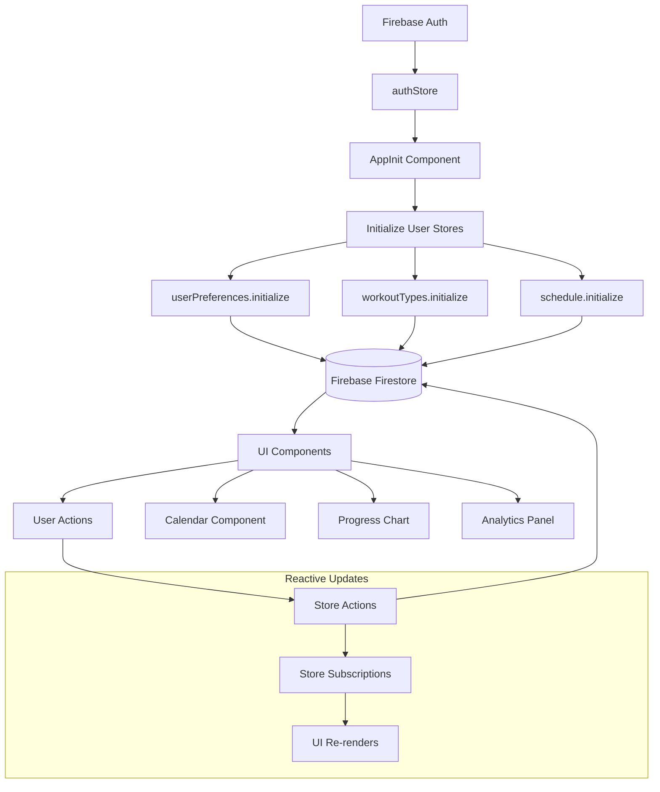

# Data Flow Research: Workout Challenge Architecture Analysis
Date: 2025-01-17
Agent: data-flow-researcher

## Executive Summary
The Workout Challenge application implements a well-structured data flow architecture using Svelte stores for state management and Firebase as the backend. The application follows unidirectional data flow patterns with reactive updates and efficient Firebase synchronization. Key strengths include clear separation of concerns, reactive UI updates, and user-scoped data isolation.

## Context
- Project: Workout Challenge - Progressive Workout Tracking PWA
- Current architecture: SvelteKit + Firebase + Svelte Stores
- Complexity level: Medium
- Related research: [Svelte Framework Analysis](../01-Research/Svelte/audit-2025-01-17.md)

## Current Data Flow Analysis

### Data Sources
- **Firebase Firestore**: Primary database for user data
  - User-scoped collections: workouts, workout_types, user_preferences
  - Real-time synchronization capabilities (not currently utilized)
- **Firebase Auth**: User authentication and session management
- **Local Storage**: Theme preferences and temporary data
- **Browser APIs**: Theme detection, service worker state
- **Client-side calculations**: Sigmoidal curve calculations, analytics

### State Locations
```
Application State Map:
├── Global State (Svelte Stores)
│   ├── authStore: User authentication state
│   ├── userPreferences: User settings and sigmoid parameters
│   ├── workoutTypes: Available workout categories
│   ├── schedule: Workout data and operations
│   └── themeStore: UI theme preferences
├── Component State
│   ├── Modal visibility states
│   ├── Form input values
│   ├── Calendar navigation state
│   └── Loading indicators
└── Server State (Firebase)
    ├── User authentication tokens
    ├── Workout records (/users/{uid}/workouts)
    ├── Workout types (/users/{uid}/workout_types)
    └── User preferences (/users/{uid}/user_preferences)
```

### Data Flow Paths


## Key Findings

### Finding 1: Well-Structured Store Architecture
**Current Implementation**:
```javascript
// Each store follows consistent pattern
function createWorkoutTypeStore() {
  const { subscribe, set, update } = writable([]);
  
  return {
    subscribe,
    initialize: async () => { /* Firebase sync */ },
    addWorkoutType: async (name, color) => { /* CRUD ops */ },
    updateWorkoutType: async (id, name, color) => { /* CRUD ops */ },
    deleteWorkoutType: async (id) => { /* CRUD ops */ }
  };
}
```

**Analysis**:
- Strengths: Clear separation of concerns, consistent API patterns, async operations
- Weaknesses: No error state management, potential race conditions
- Scalability: Good foundation but needs error handling improvements

**Recommended Approach**:
```javascript
// Enhanced store with error handling
function createWorkoutTypeStore() {
  const { subscribe, set, update } = writable({
    data: [],
    loading: false,
    error: null
  });
  
  return {
    subscribe,
    initialize: async () => {
      update(state => ({ ...state, loading: true, error: null }));
      try {
        const data = await getWorkoutTypes();
        update(state => ({ data, loading: false, error: null }));
      } catch (error) {
        update(state => ({ ...state, loading: false, error }));
      }
    },
    // ... other methods with similar error handling
  };
}
```

### Finding 2: Firebase Authentication-Driven Initialization
**Current Implementation**:
```javascript
// AppInit.svelte - Sequence-dependent initialization
onMount(async () => {
  await authStore.initialize();
  
  authStore.subscribe(async (authState) => {
    if (authState.user && !authState.loading) {
      await userPreferences.initialize();
    }
  });
});
```

**Analysis**:
- Strengths: Proper dependency management, user-scoped data access
- Weaknesses: Sequential initialization could be optimized
- Scalability: Robust pattern for user-based applications

**Recommended Approach**:
```javascript
// Parallel initialization after auth
authStore.subscribe(async (authState) => {
  if (authState.user && !authState.loading) {
    await Promise.allSettled([
      userPreferences.initialize(),
      workoutTypes.initialize(),
      schedule.initialize()
    ]);
  }
});
```

### Finding 3: Optimistic UI Updates
**Current Implementation**:
```javascript
// scheduleStore.ts - Immediate UI update followed by sync
async function addWorkout(date, duration, workout_type_id) {
  const data = await saveWorkout({ date, duration, type: workout_type_id });
  workouts.update(w => [data, ...w]); // Update after server response
}
```

**Analysis**:
- Strengths: Data consistency ensured by server-first approach
- Weaknesses: Slower perceived performance, no offline support
- Scalability: Reliable but could benefit from optimistic updates

**Recommended Approach**:
```javascript
// Optimistic update with rollback
async function addWorkout(date, duration, workout_type_id) {
  const tempId = `temp-${Date.now()}`;
  const tempWorkout = { id: tempId, date, duration, type: workout_type_id };
  
  // Optimistic update
  workouts.update(w => [tempWorkout, ...w]);
  
  try {
    const data = await saveWorkout({ date, duration, type: workout_type_id });
    // Replace temp with real data
    workouts.update(w => w.map(workout => 
      workout.id === tempId ? data : workout
    ));
  } catch (error) {
    // Rollback on error
    workouts.update(w => w.filter(workout => workout.id !== tempId));
    throw error;
  }
}
```

## State Management Analysis

### Current Solution
- **Technology**: Native Svelte stores (writable, derived, readable)
- **Complexity**: Medium - 5 main stores with clear responsibilities
- **Performance**: Good - Reactive updates, minimal re-renders
- **Type Safety**: Partial - TypeScript interfaces but runtime validation missing

### Store Responsibilities
1. **authStore**: Authentication state and Firebase Auth integration
2. **userPreferences**: User settings, sigmoid parameters, date preferences
3. **workoutTypes**: Workout categories with color coding
4. **schedule**: Workout CRUD operations and data management
5. **themeStore**: UI theme persistence and system integration

### Recommendations
1. **Short-term**: Add error states to all stores, implement loading indicators
2. **Medium-term**: Add optimistic updates, offline queue, data validation
3. **Long-term**: Consider state machines for complex flows, add data caching layer

## API Integration Patterns

### Current Approach
```javascript
// firebase.ts - Service layer pattern
export async function saveWorkout(workout) {
  const user = getCurrentUser();
  const workoutData = {
    user_id: user.uid,
    date: workout.date,
    duration: workout.duration,
    type: workout.type || 'default',
    created_at: new Date().toISOString()
  };
  
  const docRef = await addDoc(collection(db, 'users', user.uid, 'workouts'), workoutData);
  return { id: docRef.id, ...workoutData };
}
```

### Data Structure
- **User Isolation**: `/users/{uid}/workouts`, `/users/{uid}/workout_types`
- **Timestamps**: Automatic created_at/updated_at fields
- **Type Safety**: TypeScript interfaces for data shapes
- **Error Handling**: Basic try/catch in stores

### Suggested Improvements
```javascript
// Enhanced service with retry logic and caching
class WorkoutService {
  private cache = new Map();
  
  async saveWorkout(workout, options = { optimistic: true }) {
    if (options.optimistic) {
      return this.optimisticSave(workout);
    }
    return this.standardSave(workout);
  }
  
  private async retryOperation(operation, maxRetries = 3) {
    for (let i = 0; i < maxRetries; i++) {
      try {
        return await operation();
      } catch (error) {
        if (i === maxRetries - 1) throw error;
        await this.delay(Math.pow(2, i) * 1000);
      }
    }
  }
}
```

## Data Validation Strategy
- **Input validation**: Client-side form validation, TypeScript types
- **Schema validation**: None currently implemented
- **Type safety**: TypeScript interfaces for compile-time checking
- **Error boundaries**: Basic error handling in stores

### Recommended Validation Layer
```javascript
// Data validation with Zod or similar
import { z } from 'zod';

const WorkoutSchema = z.object({
  date: z.string().regex(/^\d{4}-\d{2}-\d{2}$/),
  duration: z.number().min(1).max(300),
  type: z.string().optional()
});

export function validateWorkout(data) {
  return WorkoutSchema.safeParse(data);
}
```

## Performance Considerations
- **Bundle size impact**: Minimal - native Svelte stores, Firebase SDK
- **Runtime performance**: Good - reactive updates, efficient subscriptions
- **Memory usage**: Low - stores cleanup automatically, no memory leaks detected
- **Network efficiency**: Room for improvement - no request deduplication or caching

### Optimization Opportunities
1. **Request Batching**: Batch multiple operations when possible
2. **Data Caching**: Implement client-side cache with TTL
3. **Lazy Loading**: Load analytics data only when needed
4. **Real-time Updates**: Utilize Firebase real-time listeners for collaborative features

## Firebase Data Synchronization

### Current Pattern
```javascript
// Pull-based synchronization
async function initialize() {
  const data = await getWorkouts();
  workouts.set(data || []);
}
```

### Real-time Capabilities (Not Utilized)
```javascript
// Potential real-time implementation
import { onSnapshot } from 'firebase/firestore';

function subscribeToWorkouts() {
  const user = getCurrentUser();
  const q = query(collection(db, 'users', user.uid, 'workouts'));
  
  return onSnapshot(q, (snapshot) => {
    const workouts = snapshot.docs.map(doc => ({
      id: doc.id,
      ...doc.data()
    }));
    workoutsStore.set(workouts);
  });
}
```

### Data Consistency Strategy
- **Eventual Consistency**: Firebase handles multi-device sync
- **Conflict Resolution**: Last-write-wins (Firebase default)
- **Offline Support**: Basic Firebase offline persistence (not configured)

## Migration Path
Given the solid foundation, focus on incremental improvements:

### Phase 1: Error Handling & Loading States (1-2 weeks)
1. Add error states to all stores
2. Implement loading indicators
3. Add retry logic for failed operations

### Phase 2: Performance Optimization (2-3 weeks)
1. Implement optimistic updates
2. Add request deduplication
3. Implement data caching layer

### Phase 3: Advanced Features (3-4 weeks)
1. Add real-time synchronization
2. Implement offline queue
3. Add collaborative features

## Testing Strategies
- **Unit testing state**: Test store methods in isolation
- **Integration testing data flows**: Test Firebase service layer
- **Mocking strategies**: Mock Firebase SDK for testing
- **E2E data scenarios**: Test complete user workflows

### Current Testing Coverage
- Limited unit tests for authStore
- No integration tests for Firebase services
- No E2E tests for data flows

### Recommended Testing Approach
```javascript
// Store testing pattern
import { vi } from 'vitest';
import { get } from 'svelte/store';

vi.mock('$lib/services/firebase', () => ({
  getWorkouts: vi.fn()
}));

test('schedule store initializes with data', async () => {
  const mockData = [{ id: '1', date: '2024-01-01', duration: 30 }];
  vi.mocked(getWorkouts).mockResolvedValue(mockData);
  
  await schedule.initialize();
  expect(get(schedule)).toEqual(mockData);
});
```

## Cache and Persistence Strategies

### Current Implementation
- **No client-side caching**: Direct Firebase calls on every request
- **Theme persistence**: LocalStorage for theme preferences
- **No offline support**: App requires network connectivity

### Recommended Caching Layer
```javascript
class DataCache {
  private cache = new Map();
  private ttl = 5 * 60 * 1000; // 5 minutes
  
  async get(key, fetchFn) {
    const cached = this.cache.get(key);
    if (cached && Date.now() - cached.timestamp < this.ttl) {
      return cached.data;
    }
    
    const data = await fetchFn();
    this.cache.set(key, { data, timestamp: Date.now() });
    return data;
  }
}
```

## Sources
- Documentation reviewed: 
  - Firebase Firestore docs
  - Svelte store documentation
  - SvelteKit architecture guide
- Codebase files analyzed:
  - `/src/lib/stores/*.ts` - All store implementations
  - `/src/lib/services/firebase.ts` - API layer
  - `/src/lib/components/AppInit.svelte` - Initialization logic
  - `/src/lib/types.ts` - Type definitions
- Patterns researched:
  - Svelte store patterns
  - Firebase best practices
  - Progressive Web App data strategies

## Related Research
- Framework state management: [Svelte Analysis](../01-Research/Svelte/audit-2025-01-17.md)
- Performance research: [Performance Analysis](../01-Research/Performance/audit-2025-01-17.md)
- Security considerations: [Security Analysis](../01-Research/Security/audit-2025-01-17.md)

## Recommendations Priority

### Critical (Immediate)
1. **Add error handling to all stores** - Prevents app crashes, improves user experience
2. **Implement loading states** - Better UX during async operations
3. **Add data validation layer** - Prevent invalid data from reaching Firebase

### Important (Next Sprint)
1. **Implement optimistic updates** - Improve perceived performance
2. **Add retry logic for failed operations** - Handle network issues gracefully
3. **Create comprehensive test suite** - Ensure data flow reliability

### Nice to have (Future)
1. **Real-time synchronization** - Multi-device collaboration
2. **Offline support with sync queue** - Offline-first experience
3. **Advanced caching strategies** - Reduce Firebase read costs
4. **State machine implementation** - Handle complex state transitions

## Open Questions
1. **Real-time requirements**: Do users need real-time collaboration features?
2. **Offline support priority**: How important is offline functionality?
3. **Data retention**: What's the long-term data archival strategy?
4. **Performance targets**: What are acceptable load times for data operations?
5. **Error recovery**: How should the app handle prolonged network failures?

## Architecture Strengths
1. **Clear separation of concerns** between stores, services, and components
2. **User-scoped data isolation** prevents data leakage
3. **Reactive UI updates** through Svelte's built-in reactivity
4. **Type safety** with TypeScript interfaces
5. **Consistent API patterns** across all stores

## Architecture Concerns
1. **Missing error states** could lead to poor user experience
2. **No data caching** increases Firebase costs and latency
3. **Sequential initialization** could be optimized for better startup performance
4. **Limited offline support** restricts app usability
5. **No request deduplication** could cause unnecessary API calls

The current data flow architecture provides a solid foundation for the workout tracking application with clear patterns and good separation of concerns. The primary focus should be on adding robustness through error handling and performance optimizations through caching and optimistic updates.