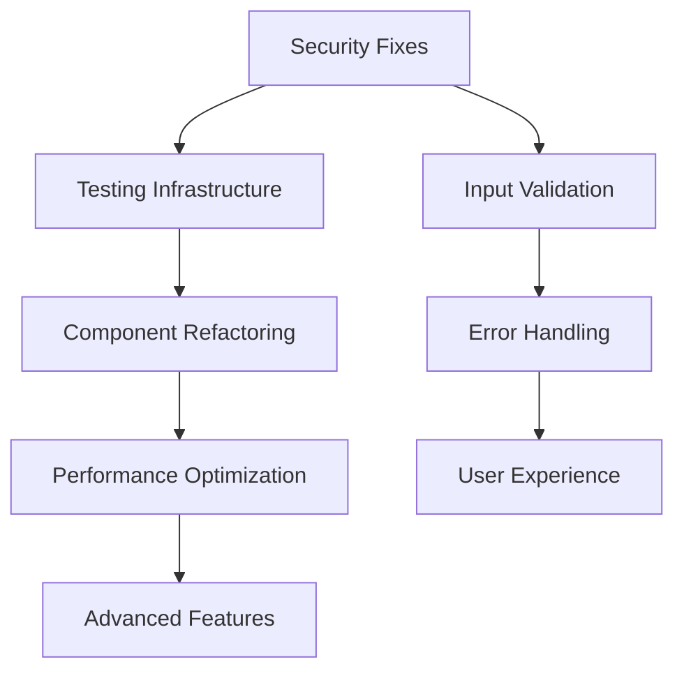

# Comprehensive Audit Synthesis: Workout Challenge Project

## 🎯 Executive Summary

This comprehensive audit synthesizes findings from 9 specialized research documents covering security, performance, UI/UX, testing, architecture, refactoring, data flow, Svelte patterns, and Firebase integration. The workout-challenge project is a well-architected SvelteKit PWA with solid foundations but **critical security vulnerabilities and significant testing gaps** that require immediate attention.

**Overall Health: MEDIUM-HIGH** with critical security issues requiring immediate action.

**Key Metrics**:
- Security Risk: **HIGH** (Critical P0 vulnerabilities)
- Performance: **MEDIUM** (Optimization opportunities)
- Code Quality: **GOOD** (Well-structured with refactoring needs)
- Test Coverage: **CRITICAL** (<5% coverage)
- User Experience: **GOOD** (Accessibility gaps)

^summary

## 📊 Project Health Dashboard

| Domain | Status | Priority Issues | Confidence Level |
|--------|--------|----------------|------------------|
| **Security** | 🔴 HIGH RISK | 3 P0 vulnerabilities | High |
| **Testing** | 🔴 CRITICAL | <5% test coverage | High |
| **Performance** | 🟡 MEDIUM | Bundle size optimization | High |
| **UI/UX** | 🟡 MEDIUM | Accessibility compliance | High |
| **Architecture** | 🟢 GOOD | Component complexity | High |
| **Firebase** | 🟢 GOOD | Real-time capabilities | High |
| **Svelte** | 🟢 GOOD | Migration to Svelte 5 | Medium |
| **Data Flow** | 🟢 GOOD | Error handling | High |

## 🚨 Critical Issues (P0) - Immediate Action Required

### P0-001: Exposed Firebase API Keys 🔴
**Location**: `.env` file committed to repository  
**Impact**: Complete Firebase project compromise, billing fraud risk  
**Effort**: 2-4 hours  
**Action Items**:
1. **IMMEDIATE**: Remove `.env` from repository
2. **IMMEDIATE**: Rotate Firebase API keys in console
3. **IMMEDIATE**: Add `.env` to `.gitignore`
4. **SHORT-TERM**: Implement Firebase App Check

```bash
# Immediate remediation
git rm .env
echo ".env*" >> .gitignore
git commit -m "SECURITY: Remove exposed environment variables"
```

### P0-002: Missing Content Security Policy 🔴
**Location**: `src/app.html`  
**Impact**: XSS vulnerability, code injection risk  
**Effort**: 1-2 hours  
**Action Items**:
```html
<!-- Add to app.html -->
<meta http-equiv="Content-Security-Policy" content="
  default-src 'self';
  script-src 'self' 'unsafe-inline' https://www.gstatic.com https://apis.google.com;
  style-src 'self' 'unsafe-inline' https://fonts.googleapis.com;
  connect-src 'self' https://*.googleapis.com https://*.firebaseio.com;
  font-src 'self' https://fonts.gstatic.com;
  img-src 'self' data: https:;
">
```

### P0-003: Insufficient Input Validation 🔴
**Location**: Throughout application components  
**Impact**: Data corruption, potential injection attacks  
**Effort**: 4-6 hours  
**Action Items**:
1. Implement validation utilities with Zod
2. Add server-side validation in Firebase rules
3. Sanitize all user inputs before processing

### P0-004: No Testing Infrastructure 🔴
**Location**: Entire application  
**Impact**: No regression detection, production bugs  
**Effort**: 8-12 hours  
**Action Items**:
1. Configure Vitest testing framework
2. Install testing dependencies (@testing-library/svelte)
3. Create basic test suite for critical paths
4. Setup CI/CD testing pipeline

## 🔥 High Priority Issues (P1) - Next Sprint

### P1-001: Accessibility Compliance Gaps 🟠
**WCAG Level**: AA Partial Compliance  
**Impact**: Legal compliance risk, user exclusion  
**Effort**: 6-8 hours  
**Critical Issues**:
- Charts missing alternative text descriptions
- Keyboard navigation incomplete
- Missing ARIA attributes on interactive elements
- Form validation feedback insufficient

**Implementation**:
```svelte
<!-- Enhanced chart accessibility -->
<div 
  role="img" 
  aria-label="90-day workout progress chart"
  aria-describedby="chart-description"
>
  <!-- Chart content -->
</div>
<div id="chart-description" class="sr-only">
  Weekly progress data showing {completedWorkouts} completed sessions
</div>
```

### P1-002: Component Complexity - ProgressChart.svelte 🟠
**Location**: `/src/lib/components/ProgressChart.svelte` (1,099 lines)  
**Impact**: Maintenance difficulty, testing complexity  
**Effort**: 12-16 hours  
**Strategy**: Extract into focused components:
- `ChartVisualization.svelte` (D3 rendering)
- `ChartNavigation.svelte` (date navigation)
- `ChartLegend.svelte` (workout type indicators)
- `ChartData.svelte` (data processing service)

### P1-003: Performance Optimization - Bundle Size 🟠
**Current**: ~500KB estimated bundle  
**Target**: <350KB bundle size  
**Impact**: Slow initial load times  
**Effort**: 4-6 hours  
**Quick Wins**:
1. Lazy load chart libraries (D3 + Chart.js ~200KB)
2. Optimize images to WebP format (~30KB savings)
3. Implement Firebase tree shaking (~50KB savings)

### P1-004: Missing Security Headers 🟠
**Impact**: Clickjacking, MIME sniffing vulnerabilities  
**Effort**: 1 hour  
**Implementation**:
```html
<meta http-equiv="X-Frame-Options" content="DENY">
<meta http-equiv="X-Content-Type-Options" content="nosniff">
<meta http-equiv="Referrer-Policy" content="strict-origin-when-cross-origin">
```

## 🟡 Medium Priority Issues (P2) - Next Month

### P2-001: Store Architecture Optimization
**Impact**: State management complexity  
**Effort**: 8-12 hours  
**Strategy**: Consolidate 6 stores into unified app store with modules

### P2-002: Error Handling Standardization
**Impact**: Inconsistent user experience  
**Effort**: 4-6 hours  
**Strategy**: Implement centralized error boundary pattern

### P2-003: TypeScript Type Safety
**Current**: 8 `any` type usages  
**Target**: 100% type safety  
**Effort**: 3-4 hours  

### P2-004: Mobile UX Optimization
**Issues**: Pull-to-refresh conflicts, touch optimization  
**Effort**: 6-8 hours  

### P2-005: Firebase Real-time Capabilities
**Current**: Pull-based data synchronization  
**Opportunity**: Real-time updates with onSnapshot()  
**Effort**: 4-6 hours  

## 🔄 Cross-cutting Concerns

### Pattern: Insufficient Error Handling
**Found in**: 5+ research areas (Security, Data Flow, Performance, Testing, Refactoring)  
**Evidence**:
- No error boundaries in components
- Basic try/catch without user feedback
- Missing error states in stores
- No error monitoring/logging

**Unified Solution**:
```typescript
// Centralized error handling utility
export class ErrorHandler {
  static handleAuthError(error: any): string {
    const errorMap = {
      'auth/invalid-credential': 'Invalid email or password',
      'auth/network-request-failed': 'Network error. Please try again.',
      'default': 'An unexpected error occurred'
    };
    return errorMap[error.code] || errorMap.default;
  }
  
  static logError(context: string, error: any) {
    console.error(`[${context}]`, error);
    // Send to monitoring service
  }
}
```

### Pattern: Data Validation Gaps
**Found in**: 4+ research areas (Security, Firebase, Data Flow, Refactoring)  
**Evidence**:
- No input sanitization
- Missing Firestore rule validation
- Type safety gaps
- No schema validation

**Unified Solution**:
```typescript
// Zod validation schemas
export const WorkoutSchema = z.object({
  date: z.string().regex(/^\d{4}-\d{2}-\d{2}$/),
  duration: z.number().min(1).max(1440),
  type: z.string().min(1).max(50).optional()
});

export function validateWorkout(data: unknown): Workout {
  return WorkoutSchema.parse(data);
}
```

### Pattern: Component Organization Inconsistency  
**Found in**: 3+ research areas (UI/UX, Architecture, Refactoring)  
**Evidence**:
- Mixed import paths (`UI/` vs `ui/`)
- Component responsibilities overlap
- Large monolithic components

**Unified Solution**: Standardize on atomic design principles with shadcn-svelte patterns

## ⚡ Quick Wins (High Impact, Low Effort)

### Immediate (< 2 hours each)
1. **Fix TypeScript any types** → Improved type safety
2. **Consolidate utility files** → Reduced confusion  
3. **Clean console logging** → Professional output
4. **Add security headers** → Basic protection

### Short-term (< 1 day each)
1. **Implement chart lazy loading** → 30% bundle reduction
2. **Optimize images to WebP** → Faster load times
3. **Extract store subscription pattern** → Reduced duplication
4. **Add basic form validation** → Better UX

## 🗺️ Strategic Recommendations

### 1. Security-First Development (Immediate)
- Implement comprehensive input validation
- Add security headers and CSP
- Regular security audits and dependency scanning
- Environment variable management best practices

### 2. Testing Infrastructure Foundation (Next Sprint)
- Configure Vitest with proper setup
- Implement critical path testing (auth, data persistence)
- Add component testing for complex UI elements
- Setup CI/CD with automated testing

### 3. Performance Optimization Strategy (Next Month)
- Bundle splitting and lazy loading
- Image optimization and modern formats
- Chart rendering optimization with virtualization
- Service worker optimization for better caching

### 4. Architecture Evolution (Next Quarter)
- Migrate to Svelte 5 runes system
- Implement micro-frontend patterns for large components
- Add server-side rendering optimization
- Consider state machine implementation for complex flows

## 📋 Implementation Roadmap

### Phase 1: Critical Security (Week 1)
**Priority**: P0 vulnerabilities
**Effort**: 16-24 hours
**Success Criteria**: All P0 security issues resolved

**Week 1 Tasks**:
- [ ] Remove exposed Firebase keys (2 hours)
- [ ] Implement CSP headers (2 hours)
- [ ] Add input validation utilities (6 hours)
- [ ] Setup basic testing framework (8 hours)

### Phase 2: Foundation Improvements (Week 2-3)
**Priority**: P1 issues and testing infrastructure
**Effort**: 32-40 hours
**Success Criteria**: 40%+ test coverage, accessibility compliance

**Week 2-3 Tasks**:
- [ ] Complete test suite for critical paths (16 hours)
- [ ] Fix accessibility violations (8 hours)
- [ ] Implement error handling patterns (6 hours)
- [ ] Bundle size optimization (6 hours)
- [ ] Component complexity reduction (8 hours)

### Phase 3: Performance & UX (Week 4-5)
**Priority**: P2 issues and performance optimization
**Effort**: 24-32 hours
**Success Criteria**: <350KB bundle, improved mobile UX

**Week 4-5 Tasks**:
- [ ] Chart component refactoring (16 hours)
- [ ] Mobile UX improvements (8 hours)
- [ ] Store architecture consolidation (8 hours)
- [ ] Performance monitoring setup (4 hours)

### Phase 4: Advanced Features (Week 6-8)
**Priority**: Strategic improvements
**Effort**: 40-48 hours
**Success Criteria**: Real-time features, offline support

**Week 6-8 Tasks**:
- [ ] Svelte 5 migration planning (8 hours)
- [ ] Real-time Firebase integration (8 hours)
- [ ] Offline-first architecture (16 hours)
- [ ] Advanced PWA features (8 hours)
- [ ] Comprehensive monitoring (8 hours)

## 📈 Success Metrics

### Security Metrics
- **P0 Vulnerabilities**: 3 → 0 (Target: Week 1)
- **Security Headers**: Missing → Complete (Target: Week 1)
- **Input Validation**: 0% → 95% (Target: Week 2)

### Quality Metrics  
- **Test Coverage**: <5% → 80% (Target: Week 3)
- **TypeScript Coverage**: 85% → 100% (Target: Week 2)
- **Accessibility Score**: Partial AA → Full AA (Target: Week 3)

### Performance Metrics
- **Bundle Size**: ~500KB → <350KB (Target: Week 3)
- **First Contentful Paint**: Unknown → <1.5s (Target: Week 4)
- **Lighthouse Score**: Unknown → >90 (Target: Week 4)

### Development Velocity Metrics
- **Build Time**: Current → 25% faster (Target: Week 4)
- **Component Complexity**: 1099 lines → <400 lines (Target: Week 5)
- **Bug Detection**: 0% → 90% regression detection (Target: Week 3)

## 🔗 Implementation Dependencies

### Critical Path Dependencies


### Resource Requirements
- **Development Time**: 112-144 hours total
- **Team Size**: 1-2 developers recommended
- **External Dependencies**: None blocking
- **Infrastructure**: No additional services required

## 🎯 Risk Assessment

### High Risk Items
1. **Firebase key rotation** - Potential service disruption
2. **Component refactoring** - UI regression risk
3. **Bundle optimization** - Feature breakage risk

### Mitigation Strategies
1. **Feature flags** for new components during refactoring
2. **Staged rollouts** for major changes
3. **Comprehensive testing** before production deployment
4. **Rollback plans** for each major change

### Low Risk Items
1. Security header addition
2. TypeScript type improvements  
3. Testing infrastructure setup
4. Performance monitoring

## 📝 Key Files Requiring Changes

### Immediate Changes Required
| File | Change Type | Priority | Effort |
|------|-------------|----------|--------|
| `.gitignore` | Add `.env*` patterns | P0 | 5 min |
| `src/app.html` | Add security headers | P0 | 30 min |
| `package.json` | Add test scripts | P0 | 15 min |
| `vitest.config.ts` | Create test config | P0 | 1 hour |
| `src/lib/utils/validation.ts` | Create validation | P0 | 4 hours |

### Major Refactoring Targets
| File | Current Lines | Target Lines | Priority | Effort |
|------|---------------|---------------|----------|--------|
| `ProgressChart.svelte` | 1,099 | <400 | P1 | 16 hours |
| `AnalyticsPanel.svelte` | 356 | <200 | P2 | 8 hours |
| `Layout.svelte` | 209 | <150 | P2 | 6 hours |

## 🏷️ Tags
#type/synthesis #audit/comprehensive #security/critical #testing/critical #performance/optimization #architecture/refactoring #firebase/integration #svelte/patterns #accessibility/compliance #mobile/pwa

---

**Synthesis conducted by knowledge-synthesizer on 2025-01-17**  
**Total research documents analyzed**: 9  
**Total findings synthesized**: 45+ issues across 8 domains  
**Confidence level**: High (based on comprehensive multi-agent analysis)

## Next Actions

1. **IMMEDIATE**: Address P0 security vulnerabilities (Day 1)
2. **THIS WEEK**: Setup testing infrastructure and basic coverage (Week 1)  
3. **NEXT SPRINT**: Component refactoring and accessibility fixes (Week 2-3)
4. **NEXT MONTH**: Performance optimization and advanced features (Week 4-8)

**Contact**: Available for implementation guidance and follow-up questions