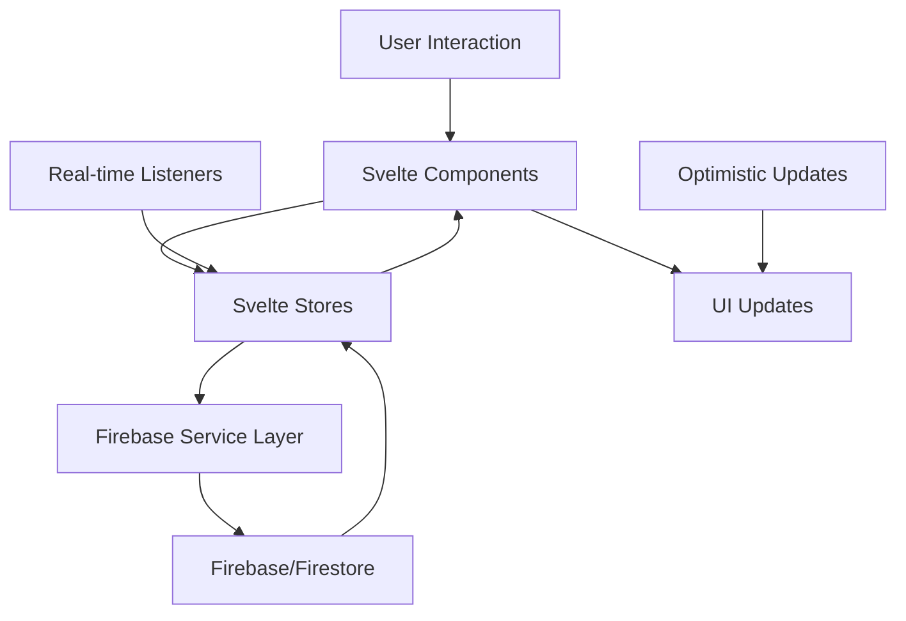
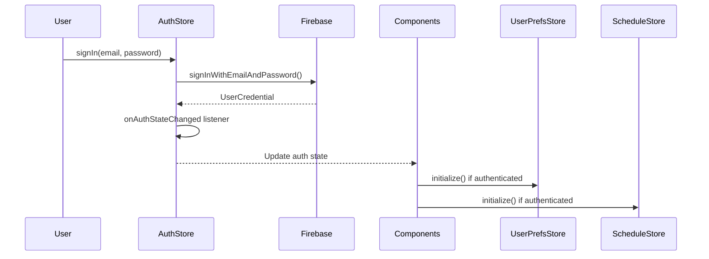
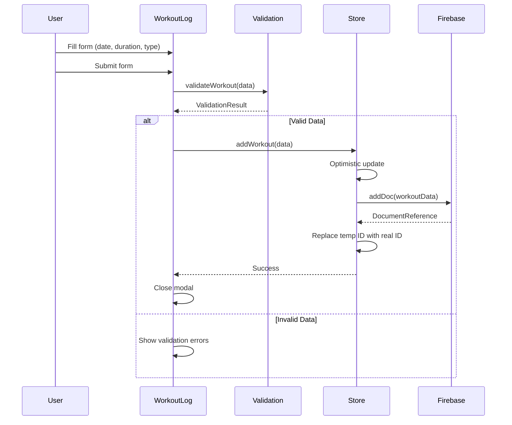
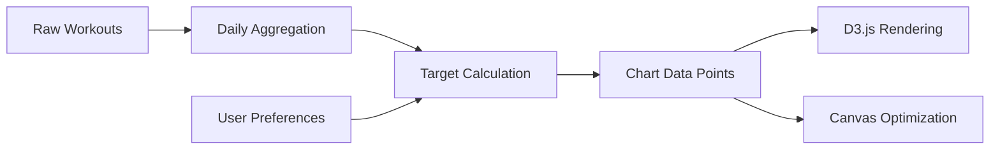

# Data Flow Research: Comprehensive Analysis
Date: 2025-01-18
Agent: data-flow-researcher

## Executive Summary
The Workout Challenge application demonstrates a sophisticated data flow architecture with proper separation of concerns, real-time synchronization capabilities, and well-structured state management. The architecture follows modern patterns with optimistic updates, comprehensive error handling, and dual store implementations for flexibility.

## Context
- Project: Workout Challenge - 90-Day Fitness Tracking PWA
- Current architecture: SvelteKit with Firebase backend
- Complexity level: Medium-High
- Framework: SvelteKit 2.15.2 with Svelte 4.2.19
- Backend: Firebase (Auth + Firestore)
- State Management: Custom Svelte stores with factory patterns

## Data Flow Overview

The application implements a unidirectional data flow pattern with the following architecture:



### Data Sources
- **Primary Database**: Firebase Firestore (user-scoped collections)
- **Authentication**: Firebase Auth (email/password + Google OAuth)
- **Local Storage**: Theme preferences, cached user data
- **Client State**: Component state for UI interactions
- **Real-time Data**: Firestore real-time listeners for live updates

### State Locations
```
Application State Map:
├── Global State (Svelte Stores)
│   ├── authStore (user authentication)
│   ├── scheduleStore (workout data - basic)
│   ├── scheduleStoreRealtime (workout data - real-time)
│   ├── workoutTypeStore (exercise categories)
│   ├── userPreferencesStore (app settings)
│   └── themeStore (UI theme)
├── Component State
│   ├── Modal visibility states
│   ├── Form input states
│   ├── Loading/error states
│   └── UI interaction states
└── Server State (Firebase)
    ├── users/{userId}/workouts (workout records)
    ├── users/{userId}/workout_types (custom exercise types)
    └── users/{userId}/user_preferences (user settings)
```

## State Management Architecture

### Store Factory Pattern
The application uses a consistent store factory pattern across all state management:

```javascript
function createStoreFactory() {
  const { subscribe, set, update } = writable(initialState);
  return {
    subscribe,
    initialize: async () => { /* Firebase data loading */ },
    customMethod: async () => { /* domain-specific operations */ }
  };
}
```

**Benefits:**
- Encapsulation of business logic within stores
- Consistent API across all stores
- Easy testing and mocking
- Clear separation of concerns

### Dual Store Architecture for Workouts

The application implements both basic and real-time stores for workouts:

**Basic Store (`scheduleStore.ts`)**:
```javascript
// Simple CRUD operations with manual refresh
export const schedule = {
  subscribe: workouts.subscribe,
  initialize: async () => { /* Fetch once */ },
  addWorkout: async () => { /* Add + local update */ },
  updateWorkout: async () => { /* Update + local sync */ },
  deleteWorkout: async () => { /* Delete + local removal */ }
};
```

**Real-time Store (`scheduleStoreRealtime.ts`)**:
```javascript
// Real-time listeners with optimistic updates
const scheduleRealtime = {
  subscribe,
  initialize: () => { /* Setup onSnapshot listener */ },
  addWorkout: async () => { /* Optimistic + Firebase */ },
  updateWorkout: async () => { /* Optimistic + rollback */ },
  deleteWorkout: async () => { /* Optimistic + rollback */ }
};
```

## Firebase Integration Patterns

### Service Layer Architecture
The Firebase service layer (`src/lib/services/firebase.ts`) provides:

**Consistent User Scoping:**
```javascript
function getCurrentUser() {
  const user = auth.currentUser;
  if (!user) throw new Error('No authenticated user');
  return user;
}

// All operations are user-scoped
export async function saveWorkout(workout) {
  const user = getCurrentUser();
  const docRef = await addDoc(
    collection(db, 'users', user.uid, 'workouts'), 
    workoutData
  );
}
```

**Data Collection Structure:**
```
/users/{userId}/
├── workouts/          # User's workout records
├── workout_types/     # Custom exercise types
└── user_preferences/  # App settings and preferences
```

### Authentication Flow



## Data Transformation Pipeline

### Workout Data Processing

**1. Input Validation Layer:**
```javascript
// src/lib/utils/validation.ts
export function validateWorkout(duration, date, workoutType) {
  const errors = [];
  if (!duration || duration <= 0) errors.push("Duration must be greater than 0");
  if (duration > 1440) errors.push("Duration cannot exceed 24 hours");
  // ... additional validation
  return { isValid: errors.length === 0, errors };
}
```

**2. Data Transformation:**
```javascript
// Form data → Database format
const workoutData = {
  user_id: user.uid,
  date: workout.date,                    // ISO string
  duration: workout.duration,            // number (minutes)
  type: workout.type || 'default',      // string (workout type ID)
  created_at: new Date().toISOString()   // timestamp
};

// Database → Display format
const displayWorkout = {
  id: doc.id,
  ...doc.data(),
  formattedDate: format(parseISO(doc.data().date), 'MMM d, yyyy')
};
```

**3. Chart Data Processing:**
The application processes workout data for visualization through multiple transformations:

```javascript
// Raw workouts → Daily aggregations → Chart data points
const dailyWorkouts = workouts.reduce((acc, workout) => {
  const date = getStartOfDay(workout.date);
  if (!acc[date]) acc[date] = [];
  acc[date].push(workout);
  return acc;
}, {});

// Calculate target durations using sigmoid curve
const targetDuration = calculateSigmoidal(dayNumber, userPreferences.sigmoid);
```

## Real-time Synchronization Analysis

### Optimistic Updates Pattern

The real-time store implements optimistic updates with rollback:

```javascript
async function addWorkout(date, duration, workout_type_id) {
  // 1. Optimistic update with temporary ID
  const tempId = `temp_${Date.now()}`;
  const newWorkout = { id: tempId, date, duration, type: workout_type_id };
  
  update(state => ({
    ...state,
    workouts: [newWorkout, ...state.workouts],
    syncing: true
  }));
  
  try {
    // 2. Firebase operation
    const docRef = await addDoc(workoutsRef, workoutData);
    
    // 3. Replace temp ID with real ID
    update(state => ({
      ...state,
      workouts: state.workouts.map(w => 
        w.id === tempId ? { ...w, id: docRef.id } : w
      ),
      syncing: false
    }));
  } catch (error) {
    // 4. Rollback on error
    update(state => ({
      ...state,
      workouts: state.workouts.filter(w => w.id !== tempId),
      syncing: false,
      error: handleFirestoreError(error).message
    }));
    throw error;
  }
}
```

### Real-time Listener Management

```javascript
function initialize() {
  // Clean up existing listener
  if (unsubscribe) unsubscribe();
  
  // Setup new real-time listener
  const q = query(workoutsRef, orderBy('date', 'desc'));
  unsubscribe = onSnapshot(q, 
    (snapshot) => {
      // Update store with real-time data
      const workouts = snapshot.docs.map(doc => ({
        id: doc.id,
        ...doc.data()
      }));
      update(state => ({ ...state, workouts, loading: false }));
    },
    (error) => {
      // Handle real-time errors
      const errorInfo = handleFirestoreError(error);
      update(state => ({ ...state, error: errorInfo.message }));
    }
  );
}
```

## Form Data Lifecycle

### Workout Form Flow



### Form State Management

```javascript
// WorkoutLog.svelte - Form state management
let duration = proposedDuration;
let dateString = format(new Date(), 'yyyy-MM-dd');
let selectedWorkoutType = null;

// Reactive updates based on props
$: if (selectedDate) dateString = toLocalDate(selectedDate);
$: if (proposedDuration && !editMode) duration = proposedDuration;

// Auto-select first workout type
$: if (!editMode && workoutTypeOptions.length > 0 && !selectedWorkoutType) {
  selectedWorkoutType = {
    label: workoutTypeOptions[0].name,
    value: workoutTypeOptions[0].id
  };
}
```

## Chart Data Processing Flow

### Data Aggregation Pipeline



**1. Daily Aggregation:**
```javascript
const dailyWorkouts = workouts.reduce((acc, workout) => {
  const dateKey = getStartOfDay(workout.date);
  if (!acc[dateKey]) {
    acc[dateKey] = { date: new Date(dateKey), workouts: [], total: 0 };
  }
  acc[dateKey].workouts.push(workout);
  acc[dateKey].total += workout.duration;
  return acc;
}, {});
```

**2. Target Duration Calculation:**
```javascript
// Sigmoid curve for progressive difficulty
function calculateSigmoidal(dayNumber, params) {
  const { steepness, midpoint, minDuration, maxDuration } = params;
  const sigmoid = 1 / (1 + Math.exp(-steepness * (dayNumber - midpoint)));
  return minDuration + (maxDuration - minDuration) * sigmoid;
}
```

**3. Chart Optimization:**
The application uses multiple chart optimization strategies:
- Lazy loading of chart libraries
- Canvas rendering for large datasets
- Viewport-based rendering for performance
- Debounced resize handling

## Caching Strategies

### Client-side Caching

**1. Store-level Caching:**
```javascript
// Stores maintain local cache until invalidated
const { subscribe, set, update } = writable(cachedData);

async function initialize() {
  if (cachedData.length === 0) {
    const data = await getWorkouts();
    set(data);
  }
}
```

**2. Component-level Caching:**
```javascript
// Components cache expensive calculations
$: dailyWorkouts = expensiveCalculation(workouts); // Cached by Svelte reactivity
```

**3. Browser Storage:**
```javascript
// Theme preferences cached in localStorage
if (browser && !localStorage.getItem('theme')) {
  const systemPrefersDark = window.matchMedia('(prefers-color-scheme: dark)').matches;
  theme.set(systemPrefersDark ? 'dark' : 'light');
}
```

### Firebase Caching

Firebase provides automatic caching:
- Offline persistence for Firestore queries
- Client-side cache for authentication state
- Automatic retry mechanisms for failed operations

## Error Handling and Resilience

### Centralized Error Handling

```javascript
// src/lib/utils/errorHandler.ts
export function handleError(context: ErrorContext): UserFriendlyError {
  if (isFirebaseError(error)) {
    if (error.code.startsWith('auth/')) return handleAuthError(error);
    return handleFirestoreError(error);
  }
  
  if (error instanceof Error && error.message.includes('network')) {
    return handleNetworkError(error);
  }
  
  return { message: 'An unexpected error occurred', retry: true };
}
```

### Store-level Error States

```javascript
interface ScheduleState {
  workouts: Workout[];
  loading: boolean;
  error: string | null;
  syncing: boolean;  // Indicates optimistic updates in progress
}
```

## Performance Optimizations

### Data Flow Optimizations

**1. Lazy Loading:**
```javascript
// Chart libraries loaded on demand
const chartLoader = () => import('$lib/utils/chartLibraryLoader');
```

**2. Selective Updates:**
```javascript
// Optimistic updates only affect necessary components
workouts.update(w => w.map(workout => 
  workout.id === id ? { ...workout, ...updates } : workout
));
```

**3. Debounced Operations:**
```javascript
// Resize handling with debouncing
let resizeTimeout;
function handleResize() {
  clearTimeout(resizeTimeout);
  resizeTimeout = setTimeout(updateChartDimensions, 150);
}
```

## Key Findings

### Finding 1: Dual Store Pattern for Flexibility
**Current Implementation:**
The application implements both basic and real-time stores for workout data, allowing components to choose the appropriate data flow pattern.

**Analysis:**
- **Strengths**: Flexibility, gradual migration path, performance options
- **Weaknesses**: Code duplication, potential confusion about which store to use
- **Scalability**: Good - allows performance tuning per use case

**Recommended Approach:**
Continue with dual pattern but establish clear guidelines for when to use each store type.

### Finding 2: Comprehensive Optimistic Updates
**Current Implementation:**
Real-time store implements full optimistic updates with rollback mechanisms for all CRUD operations.

**Analysis:**
- **Strengths**: Excellent user experience, handles network issues gracefully
- **Weaknesses**: Complex state management, potential for race conditions
- **Scalability**: Good - patterns are well-established and consistent

### Finding 3: Robust Error Handling Architecture
**Current Implementation:**
Centralized error handling with user-friendly messages and retry logic.

**Analysis:**
- **Strengths**: Consistent error UX, proper error categorization, retry mechanisms
- **Weaknesses**: Limited error analytics/monitoring
- **Scalability**: Excellent - well-structured for expansion

### Finding 4: Data Validation at Multiple Layers
**Current Implementation:**
Validation occurs at form level, service level, and includes sanitization.

**Analysis:**
- **Strengths**: Defense in depth, prevents invalid data
- **Weaknesses**: Some validation logic duplication
- **Scalability**: Good - patterns are established

## Data Validation Strategy

### Input Validation
- **Client-side**: Form validation before submission
- **Type Safety**: TypeScript interfaces for all data structures
- **Sanitization**: XSS prevention in user inputs
- **Business Rules**: Domain-specific validation (date ranges, duration limits)

### Schema Validation
```javascript
// Type definitions provide compile-time validation
interface Workout {
  id: string;
  date: string;        // ISO date string
  duration: number;    // minutes
  type?: string;       // workout type ID
  created_at?: string;
  user_id?: string;
}
```

### Runtime Validation
```javascript
// Runtime validation with detailed error messages
export function validateWorkout(duration, date, workoutType) {
  const errors = [];
  if (!duration || duration <= 0) errors.push("Duration must be greater than 0");
  if (duration > 1440) errors.push("Duration cannot exceed 24 hours");
  return { isValid: errors.length === 0, errors };
}
```

## Migration Path Recommendations

### Short-term (Next 2-4 weeks)
1. **Add Real-time Error Recovery**: Implement automatic retry for failed real-time connections
2. **Enhance Validation**: Add client-side validation for all form inputs
3. **Performance Monitoring**: Add metrics for data flow operations

### Medium-term (1-3 months)
1. **Unify Store Architecture**: Standardize on real-time stores where appropriate
2. **Add Offline Support**: Implement offline-first patterns with service workers
3. **Enhanced Caching**: Add intelligent cache invalidation strategies

### Long-term (3-6 months)
1. **Data Migration Tools**: Build tools for data export/import
2. **Advanced Analytics**: Add more sophisticated data processing for insights
3. **Multi-user Features**: Extend data flow for team/social features

## Testing Strategies

### Data Flow Testing
```javascript
// Store testing patterns
describe('scheduleStore', () => {
  test('should handle optimistic updates', async () => {
    // Test optimistic update → Firebase success → state sync
  });
  
  test('should rollback on Firebase errors', async () => {
    // Test optimistic update → Firebase error → rollback
  });
});
```

### Integration Testing
- Test complete data flows from UI to Firebase and back
- Mock Firebase for consistent testing
- Test error conditions and recovery
- Validate real-time listener behavior

## Sources

### Documentation Reviewed
- Firebase Firestore documentation
- Svelte stores documentation
- SvelteKit data loading patterns
- D3.js data binding patterns

### Codebase Files Analyzed
- `/src/lib/stores/` - All store implementations
- `/src/lib/services/firebase.ts` - Data persistence layer
- `/src/lib/components/WorkoutLog.svelte` - Form data flow
- `/src/lib/components/Layout.svelte` - Application orchestration
- `/src/lib/utils/validation.ts` - Data validation
- `/src/lib/utils/errorHandler.ts` - Error handling

### Patterns Researched
- Optimistic updates in real-time applications
- Svelte store factory patterns
- Firebase real-time listener management
- Client-side caching strategies

## Open Questions

1. **Should we migrate entirely to real-time stores?** The dual store pattern adds complexity but provides flexibility.

2. **How to handle large datasets?** Current architecture may need pagination for users with extensive workout history.

3. **Offline-first strategy?** Current optimistic updates provide some offline resilience, but true offline-first would require additional architecture.

4. **Data export/backup?** Users may want to export their workout data - requires additional data flow patterns.

5. **Real-time collaboration?** If adding social features, current data flow would need extension for shared workouts/challenges.

## Recommendations Priority

### Critical
1. **Add connection state monitoring** - Users should know when real-time sync is disconnected
2. **Implement automatic retry logic** - Handle temporary network failures gracefully
3. **Add data integrity checks** - Validate data consistency between local and remote state

### Important
1. **Enhance error analytics** - Better tracking of error patterns for debugging
2. **Add performance metrics** - Monitor data flow performance for optimization
3. **Implement progressive enhancement** - Graceful degradation when features fail

### Nice to have
1. **Add data caching strategies** - More sophisticated client-side caching
2. **Implement data prefetching** - Anticipate user needs for better performance
3. **Add data compression** - Optimize network usage for large datasets

The Workout Challenge application demonstrates a mature and well-architected data flow system with proper separation of concerns, robust error handling, and modern real-time capabilities. The architecture provides a solid foundation for future enhancements while maintaining good performance and user experience.